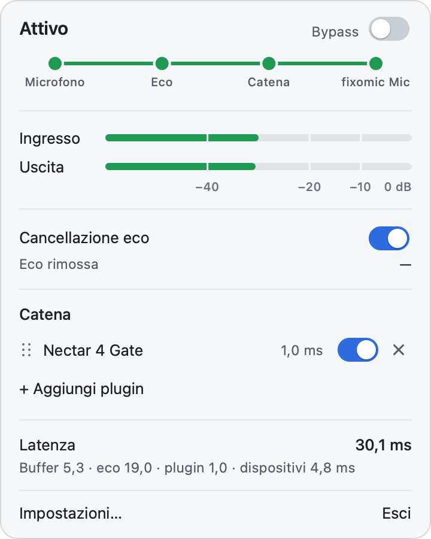
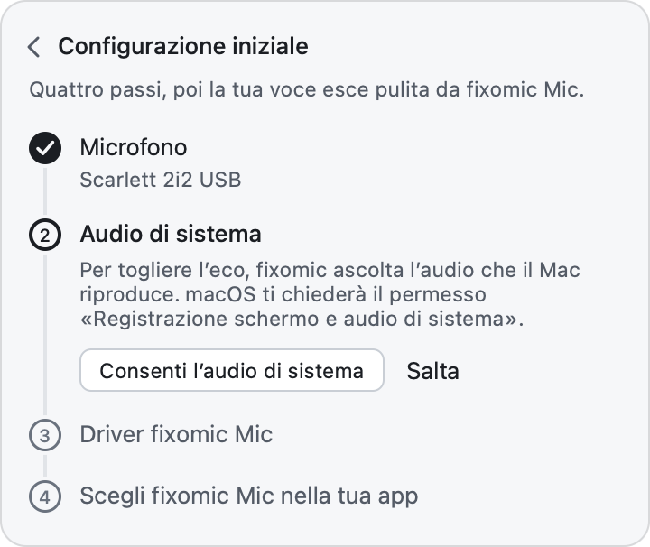
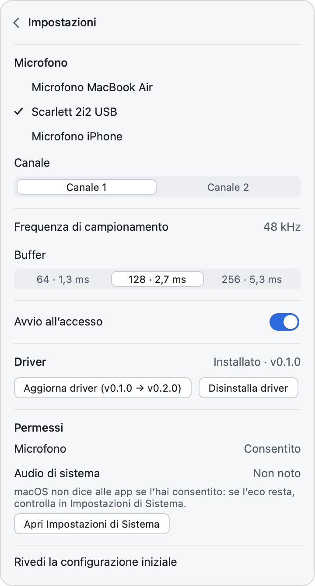

# fixomic

**Il microfono del Mac senza eco, con i tuoi plugin AU e VST3, per Discord, Zoom e qualsiasi app.**

<picture>
  <source media="(prefers-color-scheme: dark)" srcset="docs/screenshots/panel-dark.png">
  
</picture>

App per la barra dei menu di macOS che sta tra il tuo microfono e app come Discord: toglie l'eco,
fa passare la voce in una catena di plugin AU e VST3 e la offre alle altre app come microfono
virtuale, **fixomic Mic**.

**Scarica:** [l'ultima versione](https://github.com/ManoloZocco/fixomic/releases/latest)
(`fixomic-<versione>.zip`, con il suo `.sha256`) · **Guida all'uso:** [docs/guida.md](docs/guida.md)

*English below: [English](#english) · [User guide](docs/guide.md).*

**Requisiti**

- macOS 14.4 o successivo.
- Un Mac con Apple Silicon o Intel: lo stesso zip va bene per entrambi.
- Un microfono che lavori a 48 kHz: quello del Mac, uno USB o uno sul jack vanno quasi sempre bene,
  quelli delle cuffie Bluetooth no (vedi [Limiti noti](#limiti-noti)).

## Cosa fa

- **Toglie l'eco.** Con le cuffie sul jack combo, o un headset vicino al microfono, quello che
  ascolti rientra nel microfono e gli altri sentono il loro audio, o il tuo video. fixomic lo
  cancella con WebRTC AEC3, usando come riferimento tutto quello che suona sul Mac.
- **Catena di plugin.** Aggiungi, riordina con il trascinamento e metti in bypass plugin AU e VST3,
  per esempio un gate e iZotope Nectar. La finestra di un plugin si apre accanto al pannello, che
  resta aperto; catena e regolazioni restano salvate.
- **fixomic Mic.** Un microfono virtuale, fornito da un driver incluso nell'app e derivato da
  BlackHole. Lo scegli in Discord, Zoom o qualsiasi altra app.
- **Solo quando serve.** Finché nessuna app usa fixomic Mic, fixomic non apre il microfono: niente
  pallino arancione e nessuna elaborazione.
- **Nella barra dei menu.** Nessuna icona nel Dock. Dal pannello hai il bypass globale (il
  microfono crudo, per confronto), i livelli, l'eco rimossa e la latenza.
- **Tutto sul Mac.** L'audio viene elaborato solo sul tuo Mac; fixomic non si collega a Internet.

La [guida all'uso](docs/guida.md) spiega passo per passo l'installazione, i permessi, come scegliere
fixomic Mic in Discord, Zoom, Teams, Meet, OBS e FaceTime, il pannello, i plugin, le impostazioni,
come funziona e cosa fare quando qualcosa non va.

## Installazione

1. Scarica `fixomic-<versione>.zip` e `fixomic-<versione>.zip.sha256` dalle
   [release](https://github.com/ManoloZocco/fixomic/releases/latest). Se vuoi, verifica il file,
   dalla cartella in cui li hai scaricati:

   ```sh
   shasum -a 256 -c fixomic-<versione>.zip.sha256
   ```

2. Apri lo zip e trascina **fixomic.app** in **Applicazioni**.
3. **L'app non è firmata da uno sviluppatore registrato presso Apple** (ha una firma ad-hoc e non è
   notarizzata), quindi al primo avvio macOS la blocca. Aprila in uno di questi modi:
   - **macOS 14:** clic destro (o Ctrl-clic) su fixomic.app → **Apri**, poi ancora **Apri**.
   - **macOS 15 e successivi:** prova ad aprirla una volta. Poi vai in **Impostazioni di Sistema →
     Privacy e sicurezza**, scorri fino in fondo, fai clic su **Apri comunque** e conferma.
   - **Da Terminale**, con qualsiasi versione:

     ```sh
     xattr -dr com.apple.quarantine /Applications/fixomic.app
     ```

4. L'icona di fixomic compare nella barra dei menu e si apre la guida del primo avvio:

   

   1. **Microfono:** concedi l'accesso e scegli il tuo microfono.
   2. **Audio di sistema:** concedi *Registrazione schermo e audio di sistema*. fixomic ascolta
      l'audio del Mac **solo per cancellare l'eco**, senza registrarlo né modificarlo. Se non lo
      concedi, tutto il resto funziona, ma l'eco non viene tolta.
   3. **Driver fixomic Mic:** vedi sotto.
   4. **Scegli fixomic Mic nella tua app:** vedi [Usarlo in Discord](#usarlo-in-discord).

   Se chiudi la guida prima della fine, il pannello mostra *Completa la configurazione*. I dettagli
   di ogni passo sono nella [guida](docs/guida.md#la-configurazione-iniziale).

### Il driver

fixomic Mic esiste solo con il driver installato. Installalo dalla guida, o dal pannello:
**Impostazioni… → Driver → Installa driver**.

macOS chiede la password di amministratore. Il driver viene copiato in
`/Library/Audio/Plug-Ins/HAL/fixomic.driver`, poi Core Audio si riavvia: l'audio del Mac si ferma
per un attimo. Quando una nuova versione di fixomic contiene un driver più recente, nello stesso
punto compare **Aggiorna driver**.



## Usarlo in Discord

In Discord: **Impostazioni utente → Voce e video → Dispositivo di input → fixomic Mic**.
fixomic si accende da solo quando Discord inizia a usare il microfono, e si spegne circa 3 secondi
dopo che ha smesso. Se vuoi sentire solo l'elaborazione di fixomic, spegni in Discord la
cancellazione dell'eco e la soppressione del rumore.

Funziona allo stesso modo in Zoom, Teams, Meet, OBS, FaceTime e in qualsiasi app che ti lascia
scegliere il microfono: i passi per ciascuna sono nella
[guida](docs/guida.md#scegliere-fixomic-mic-nelle-app). Per i giochi e le app che usano solo
l'ingresso predefinito del Mac, scegli fixomic Mic in **Impostazioni di Sistema → Suono → Ingresso**.

## Latenza

La riga *Latenza* del pannello mostra quanto la tua voce arriva in ritardo alle altre app:
buffer, cancellazione dell'eco, plugin e dispositivi. Sono cifre calcolate dalle latenze che
ciascuna parte dichiara, non una misura da capo a capo.

Quello che aggiunge fixomic, senza plugin:

| | Buffer 64 | Buffer 128 (predefinito) |
|---|---|---|
| Cancellazione eco attiva | 21,6 ms | 24,3 ms |
| Cancellazione eco spenta | 2,7 ms | 5,3 ms |

È il doppio del buffer (un buffer per ricevere l'audio, uno per consegnarlo), più la cancellazione
dell'eco quando è attiva. Il totale del pannello comprende anche la latenza che i plugin dichiarano
e quella dei dispositivi. Sul Mac di sviluppo, con le cuffie HyperX sul jack combo, i dispositivi
aggiungono circa 4,8 ms: senza plugin il pannello mostra 29,1 ms (eco attiva, buffer 128), 10,2 ms
(eco spenta, buffer 128) e 7,5 ms (eco spenta, buffer 64).

Gli obiettivi del progetto riguardano solo quello che aggiunge fixomic: ≤ 16 ms con la
cancellazione dell'eco e ≤ 5 ms senza. **Con la cancellazione attiva non è raggiunto:** 24,3 ms.
Il motivo è WebRTC AEC3, che da solo aggiunge 19,0 ms (910 campioni a 48 kHz). Lavora a blocchi
fissi di 10 ms, e fixomic tiene un blocco di scorta per disaccoppiarlo dal buffer; il resto è il
ritardo interno dell'AEC3, circa 9 ms. Con la cancellazione spenta, 5,3 ms con buffer 128 sono
appena oltre l'obiettivo; con buffer 64, 2,7 ms lo rispettano. Per confronto, Discord aggiunge da
solo circa 20 ms di codifica, più la rete. Se le tue cuffie non rientrano nel microfono, spegni la
cancellazione dell'eco: risparmi quei 19 ms.

## Limiti noti

- **Solo microfoni a 48 kHz.** fixomic lavora soltanto a 48 kHz e rifiuta un microfono che non li
  offre: il pannello mostra *Questo microfono non supporta 48 kHz*. È il caso di quasi tutti i
  microfoni delle cuffie Bluetooth, che nelle chiamate passano al profilo HFP a 16 o 24 kHz. Usa il
  microfono del Mac, uno USB o uno sul jack, e le cuffie Bluetooth solo per ascoltare.
- **I permessi si chiedono di nuovo dopo ogni aggiornamento.** L'app è firmata ad-hoc, non da uno
  sviluppatore registrato presso Apple: per macOS ogni versione è un'app diversa, quindi dopo un
  aggiornamento chiede di nuovo il microfono e la *Registrazione schermo e audio di sistema*.
- **Latenza con la cancellazione dell'eco** oltre l'obiettivo del progetto: vedi [Latenza](#latenza).
- **Il muto del driver funziona ancora.** Il muto di fixomic Mic è condiviso con il Bridge nascosto.
  Se un'app o un'utility mette in muto fixomic Mic, l'uscita resta in silenzio mentre i misuratori
  di fixomic continuano a muoversi. Per toglierlo, apri *Configurazione Audio MIDI* → fixomic Mic e
  deseleziona *Muto*.
- **I plugin girano dentro fixomic.** Un plugin che si blocca fa chiudere fixomic, e fixomic Mic dà
  silenzio finché non lo riapri. Il caso di un plugin che fa chiudere fixomic all'avvio è gestito:
  vedi sotto.

## Se qualcosa non va

Le risposte complete sono nella guida, in
[Problemi e domande frequenti](docs/guida.md#problemi-e-domande-frequenti). I casi più comuni:

- **Un plugin non compare più tra quelli da aggiungere.** Un plugin che fa cadere la scansione
  finisce in una lista nera e non viene più provato. Per riprovarlo, esci da fixomic e cancella la
  cache dei plugin, poi riapri fixomic, che li analizza di nuovo tutti:

  ```sh
  rm ~/Library/Application\ Support/fixomic/plugins.xml
  ```

- **All'avvio compare *L’ultimo avvio si è interrotto caricando i plugin*.** Un plugin della catena
  ha fatto chiudere fixomic all'avvio precedente. Questa volta la catena è caricata senza plugin
  (le righe dicono *Plugin non trovato*): togli quello che dà problemi. Al prossimo avvio fixomic
  riprova a caricare gli altri.
- **fixomic riceve solo silenzio dall'audio di sistema** e l'eco resta: controlla che fixomic sia
  abilitato in **Impostazioni di Sistema → Privacy e sicurezza → Registrazione schermo e audio di
  sistema**. L'avviso può comparire anche durante una chiamata in cui nessuno parla.
- **Il volume di fixomic Mic** in Impostazioni di Sistema non ha effetto, così le app che regolano
  da sole il livello del microfono (Zoom) non possono abbassarlo. Il livello si regola con i plugin
  della catena.

## Disinstallazione

1. Nel pannello: **Impostazioni… → Driver → Disinstalla driver**, conferma con **Disinstalla** e
   inserisci la password. fixomic Mic sparisce da tutte le app.
2. Se avevi attivato **Avvio all’accesso**, spegnilo.
3. Esci da fixomic (**Esci** nel pannello o nel menu dell'icona) e sposta fixomic.app nel Cestino.
4. Se vuoi, cancella anche le impostazioni (catena, plugin, microfono scelto) e i permessi:

   ```sh
   rm -rf ~/Library/Application\ Support/fixomic
   tccutil reset All it.manolozocco.fixomic
   ```

Se hai già cancellato l'app e il driver è rimasto, toglilo dal Terminale:

```sh
sudo rm -rf /Library/Audio/Plug-Ins/HAL/fixomic.driver && sudo killall coreaudiod
```

## Compilare dai sorgenti

Prerequisiti:

- macOS 14.4 o successivo.
- **Xcode**: non bastano gli strumenti da riga di comando, perché il driver si compila con
  `xcodebuild`. Se `xcodebuild` dice che serve Xcode, sceglilo con
  `sudo xcode-select -s /Applications/Xcode.app`.
- [Homebrew](https://brew.sh), con:

  ```sh
  brew install cmake ninja meson
  ```

- Una connessione a Internet per la prima compilazione: gli script scaricano WebRTC audio
  processing (da freedesktop.org) e Abseil, CMake scarica JUCE e Catch2.

```sh
git clone --recurse-submodules https://github.com/ManoloZocco/fixomic.git
cd fixomic
scripts/build-webrtc-apm.sh            # una volta: WebRTC AEC3, librerie statiche arm64, x86_64 e universali
scripts/build-driver.sh                # il driver universale, in build/driver (finisce dentro l'app)
cmake -S . -B build -G Ninja           # Debug
cmake --build build
./build/fixomic_tests "~[hardware]"    # i test che non richiedono dispositivi audio
open build/fixomic_artefacts/Debug/fixomic.app
```

Se hai clonato senza `--recurse-submodules`: `git submodule update --init driver/BlackHole`.

Note:

- **Test.** I test `[gui]` aprono finestre sullo schermo; per saltarli anche loro:
  `./build/fixomic_tests "~[hardware]~[gui]"`. I test `[hardware]` usano i dispositivi audio veri
  e il driver installato, e aprono il microfono.
- **Firma.** CMake firma l'app con la prima identità *Apple Development* del portachiavi, se c'è,
  altrimenti ad-hoc. Con la firma ad-hoc macOS chiede di nuovo i permessi a ogni build. Puoi
  sceglierla con `-DFIXOMIC_CODESIGN_IDENTITY="…"`, oppure `-` per ad-hoc.
- **Driver senza l'app**, per lo sviluppo: `sudo scripts/install-driver.sh`,
  `sudo scripts/uninstall-driver.sh` e `./build/fxprobe check-driver`. I dettagli sono in
  [driver/README.md](driver/README.md).
- **Release.** `scripts/package-release.sh` compila la build Release universale (arm64 + x86_64) in
  `build-release/` e la firma ad-hoc, senza hardened runtime. Il risultato è
  `dist/fixomic-<versione>.zip` con il suo `.sha256`. Lo script controlla le architetture, la
  firma, il driver incluso, le licenze, l'assenza della quarantena e dei comandi da sviluppatore.
  Con `--clean` riparte da zero.
- **Prove di accettazione:** [docs/acceptance.md](docs/acceptance.md).

## Licenze

- **fixomic**: GNU Affero General Public License v3.0 o successiva ([LICENSE](LICENSE)).
- **Driver** (`driver/`, fixomic.driver): GNU General Public License v3.0
  ([driver/LICENSE](driver/LICENSE)). È una build non ufficiale di
  [BlackHole](https://github.com/ExistentialAudio/BlackHole) di Existential Audio, che non la
  sostiene in alcun modo.
- **Terze parti**: JUCE (AGPL-3.0), WebRTC audio processing (BSD-3-Clause), Abseil (Apache-2.0), il
  VST3 SDK (MIT) e le altre componenti incluse sono elencate in [NOTICE](NOTICE). I testi delle
  licenze sono anche dentro l'app, in `fixomic.app/Contents/Resources/Licenses`. Catch2 (BSL-1.0)
  serve solo ai test.
- **Codice sorgente**: tutto il sorgente dell'app e del driver, come chiedono la AGPL-3.0 e la
  GPL-3.0, è in questo repository, <https://github.com/ManoloZocco/fixomic>. Le release si
  scaricano dallo stesso repository.

---

## English

**Your Mac's microphone without echo, through your own AU and VST3 plugins, for Discord, Zoom and
any app.**

fixomic is a macOS menu-bar app that sits between your microphone and apps like Discord. It removes
echo, runs your voice through a chain of AU and VST3 plugins, and offers the result to other apps as
a virtual microphone, **fixomic Mic**. The screenshots are above.

**Download:** [the latest release](https://github.com/ManoloZocco/fixomic/releases/latest)
(`fixomic-<version>.zip`, with its `.sha256`) · **User guide:** [docs/guide.md](docs/guide.md)

**Requirements**

- macOS 14.4 or later.
- A Mac with Apple Silicon or Intel: the same zip works on both.
- A microphone that works at 48 kHz: the Mac's own, a USB one or one on the jack almost always do;
  Bluetooth headset microphones do not (see [Known limitations](#known-limitations)).

### What it does

- **Removes echo.** With headphones on the combo jack, or a headset close to the microphone, what
  you hear leaks into the microphone, and the others hear their own audio, or your video. fixomic
  cancels it with WebRTC AEC3, using everything that plays on the Mac as the reference.
- **Plugin chain.** Add, reorder by dragging and bypass AU and VST3 plugins, for example a gate and
  iZotope Nectar. A plugin's window opens beside the panel, which stays open; the chain and its
  settings are saved.
- **fixomic Mic.** A virtual microphone, provided by a driver that ships inside the app and is
  derived from BlackHole. You choose it in Discord, Zoom or any other app.
- **Only when needed.** While no app uses fixomic Mic, fixomic does not open the microphone: no
  orange dot, no processing.
- **In the menu bar.** No Dock icon. The panel has a global bypass (the raw microphone, to
  compare), the levels, the echo removed and the latency.
- **Everything stays on the Mac.** Audio is processed only on your Mac; fixomic does not connect to
  the Internet.

The [user guide](docs/guide.md) covers installation, the permissions, choosing fixomic Mic in
Discord, Zoom, Teams, Meet, OBS and FaceTime, the panel, plugins, settings, how it works and what to
do when something goes wrong.

### Latency

The panel's *Latenza* row shows how late your voice reaches other apps: buffer, echo cancellation,
plugins and devices. These figures are computed from the latency each part declares, not measured
end to end.

What fixomic adds, without plugins:

| | Buffer 64 | Buffer 128 (default) |
|---|---|---|
| Echo cancellation on | 21.6 ms | 24.3 ms |
| Echo cancellation off | 2.7 ms | 5.3 ms |

That is twice the buffer (one buffer to receive the audio, one to deliver it), plus echo
cancellation when it is on. The panel's total also includes the latency the plugins declare and the
devices' own. On the development Mac, with the HyperX headset on the combo jack, the devices add
about 4.8 ms: without plugins the panel shows 29.1 ms (echo cancellation on, buffer 128), 10.2 ms
(off, buffer 128) and 7.5 ms (off, buffer 64).

The project's targets are about what fixomic adds: ≤ 16 ms with echo cancellation and ≤ 5 ms
without. **With echo cancellation on it is not met:** 24.3 ms. The reason is WebRTC AEC3, which
alone adds 19.0 ms (910 samples at 48 kHz). It works in fixed 10 ms blocks, and fixomic keeps one
block in reserve to decouple it from the buffer; the rest is AEC3's own internal delay, about 9 ms.
With echo cancellation off, 5.3 ms at buffer 128 is just over the target; at buffer 64, 2.7 ms
meets it. For comparison, Discord alone adds about 20 ms of encoding, plus the network. If your
headphones do not leak into the microphone, turn echo cancellation off and save those 19 ms.

### Installing

1. Download `fixomic-<version>.zip` and `fixomic-<version>.zip.sha256` from the
   [releases](https://github.com/ManoloZocco/fixomic/releases/latest). To check the file, from the
   folder you downloaded them to: `shasum -a 256 -c fixomic-<version>.zip.sha256`.
2. Open the zip and drag **fixomic.app** to **Applications**.
3. **The app is not signed by a developer registered with Apple** (it has an ad-hoc signature and is
   not notarised), so macOS blocks it on the first launch. Open it in one of these ways:
   - **macOS 14:** right-click (or Control-click) fixomic.app → **Open**, then **Open** again.
   - **macOS 15 and later:** try to open it once. Then go to **System Settings → Privacy &
     Security**, scroll to the bottom, click **Open Anyway** and confirm.
   - **From Terminal**, on any version: `xattr -dr com.apple.quarantine /Applications/fixomic.app`
4. The fixomic icon appears in the menu bar and the first-run guide opens. The app's interface is
   in Italian; the four steps are:
   1. **Microfono** (microphone): grant access and choose your microphone.
   2. **Audio di sistema** (system audio): grant *Screen & System Audio Recording*. fixomic listens
      to the Mac's audio **only to cancel echo**, without recording or changing it. Without it,
      everything else works, but echo is not removed.
   3. **Driver fixomic Mic**: see below.
   4. **Scegli fixomic Mic nella tua app** (choose fixomic Mic in your app): see
      [Using it in Discord](#using-it-in-discord).

   If you close the guide before the end, the panel shows *Completa la configurazione* (complete the
   setup). Each step is explained in the [user guide](docs/guide.md#the-first-run-guide).

#### The driver

fixomic Mic exists only with the driver installed. Install it from the guide, or from the panel:
**Impostazioni… (Settings) → Driver → Installa driver**.

macOS asks for an administrator password. The driver is copied to
`/Library/Audio/Plug-Ins/HAL/fixomic.driver`, then Core Audio restarts, so the Mac's audio stops for
a moment. When a new fixomic version carries a newer driver, **Aggiorna driver** (update) appears in
the same place.

### Using it in Discord

In Discord: **User Settings → Voice & Video → Input Device → fixomic Mic** (in Italian:
*Impostazioni utente → Voce e video → Dispositivo di input*). fixomic turns on by itself when
Discord starts using the microphone, and off about 3 seconds after it stops. To hear only
fixomic's processing, turn off Discord's own echo cancellation and noise suppression.

It works the same way in Zoom, Teams, Meet, OBS, FaceTime and any app that lets you choose the
microphone: the steps for each are in the [user guide](docs/guide.md#choosing-fixomic-mic-in-your-apps).
For games and apps that only use the Mac's default input, choose fixomic Mic in **System Settings →
Sound → Input**.

### Known limitations

- **48 kHz microphones only.** fixomic works only at 48 kHz and refuses a microphone that does not
  offer it: the panel shows *Questo microfono non supporta 48 kHz*. That is the case for almost
  every Bluetooth headset microphone, which switches to the HFP profile at 16 or 24 kHz during
  calls. Use the Mac's microphone, a USB one or one on the jack, and the Bluetooth headset only to
  listen.
- **Permissions are asked again after every update.** The app is signed ad-hoc, not by a developer
  registered with Apple: to macOS every version is a different app, so after an update it asks
  again for the microphone and for *Screen & System Audio Recording*.
- **Latency with echo cancellation** is over the project's target: see [Latency](#latency).
- **The driver's mute still works.** The mute of fixomic Mic is shared with the hidden Bridge. If
  an app or utility mutes fixomic Mic, it goes silent while fixomic's own meters still move. To clear
  it, open *Audio MIDI Setup* → fixomic Mic and uncheck *Mute*.
- **Plugins run inside fixomic.** A plugin that crashes makes fixomic quit, and fixomic Mic gives
  silence until you open it again. A plugin that makes fixomic quit at launch is handled: see below.

### Troubleshooting

The full answers are in the guide, under [Troubleshooting and FAQ](docs/guide.md#troubleshooting-and-faq).
The most common cases:

- **A plugin no longer shows up among those you can add.** A plugin that crashes the scan is
  blacklisted and not tried again. To retry it, quit fixomic and delete the plugin cache, then open
  fixomic again, which scans them all anew:
  `rm ~/Library/Application\ Support/fixomic/plugins.xml`.
- **At launch, *L’ultimo avvio si è interrotto caricando i plugin* appears** (the last launch was
  interrupted while loading the plugins). A plugin in the chain made fixomic quit at the previous
  launch. This time the chain is loaded without plugins (its rows say *Plugin non trovato*): remove
  the one causing trouble. At the next launch fixomic tries to load the others again.
- **fixomic receives only silence from the system audio** and echo remains: check that fixomic is
  enabled in **System Settings → Privacy & Security → Screen & System Audio Recording**. The notice
  can also appear during a call in which nobody speaks.
- **fixomic Mic's volume** in System Settings has no effect, so apps that adjust the microphone
  level by themselves (Zoom) cannot lower it. Set the level with the plugins in the chain.

### Uninstalling

1. In the panel: **Impostazioni… → Driver → Disinstalla driver**, confirm with **Disinstalla** and
   enter your password. fixomic Mic disappears from every app.
2. If you turned on **Avvio all’accesso** (launch at login), turn it off.
3. Quit fixomic (**Esci** in the panel or in the icon's menu) and move fixomic.app to the Trash.
4. Optionally, delete the settings (chain, plugins, chosen microphone) and the permissions:
   `rm -rf ~/Library/Application\ Support/fixomic` and
   `tccutil reset All it.manolozocco.fixomic`.

If you already deleted the app and the driver is still there, remove it from Terminal:
`sudo rm -rf /Library/Audio/Plug-Ins/HAL/fixomic.driver && sudo killall coreaudiod`.

### Building from source

Prerequisites:

- macOS 14.4 or later.
- **Xcode**: the command-line tools alone are not enough, as the driver is built with `xcodebuild`.
  If `xcodebuild` says it needs Xcode, select it with `sudo xcode-select -s /Applications/Xcode.app`.
- [Homebrew](https://brew.sh), with `brew install cmake ninja meson`.
- An Internet connection for the first build: the scripts download WebRTC audio processing (from
  freedesktop.org) and Abseil, and CMake downloads JUCE and Catch2.

```sh
git clone --recurse-submodules https://github.com/ManoloZocco/fixomic.git
cd fixomic
scripts/build-webrtc-apm.sh            # once: WebRTC AEC3, static libraries for arm64, x86_64 and universal
scripts/build-driver.sh                # the universal driver, in build/driver (it goes inside the app)
cmake -S . -B build -G Ninja           # Debug
cmake --build build
./build/fixomic_tests "~[hardware]"    # the tests that need no audio devices
open build/fixomic_artefacts/Debug/fixomic.app
```

If you cloned without `--recurse-submodules`: `git submodule update --init driver/BlackHole`.

Notes:

- **Tests.** The `[gui]` tests open windows on the screen; to skip them too:
  `./build/fixomic_tests "~[hardware]~[gui]"`. The `[hardware]` tests use the real audio devices
  and the installed driver, and open the microphone.
- **Signing.** CMake signs the app with the first *Apple Development* identity in the keychain, if
  there is one, otherwise ad-hoc. With an ad-hoc signature, macOS asks for the permissions again
  after every build. Choose one with `-DFIXOMIC_CODESIGN_IDENTITY="…"`, or `-` for ad-hoc.
- **Driver without the app**, for development: `sudo scripts/install-driver.sh`,
  `sudo scripts/uninstall-driver.sh` and `./build/fxprobe check-driver`. Details are in
  [driver/README.md](driver/README.md).
- **Release.** `scripts/package-release.sh` builds the universal (arm64 + x86_64) Release build in
  `build-release/` and signs it ad-hoc, without the hardened runtime. The result is
  `dist/fixomic-<version>.zip` with its `.sha256`. The script checks the architectures, the
  signature, the bundled driver, the licences, and that there is no quarantine and no developer
  command. `--clean` starts from scratch.
- **Acceptance tests:** [docs/acceptance.md](docs/acceptance.md) (in Italian).

### Licences

- **fixomic**: GNU Affero General Public License v3.0 or later ([LICENSE](LICENSE)).
- **Driver** (`driver/`, fixomic.driver): GNU General Public License v3.0
  ([driver/LICENSE](driver/LICENSE)). It is an unofficial build of
  [BlackHole](https://github.com/ExistentialAudio/BlackHole) by Existential Audio, which does not
  endorse it.
- **Third parties**: JUCE (AGPL-3.0), WebRTC audio processing (BSD-3-Clause), Abseil (Apache-2.0),
  the VST3 SDK (MIT) and the other bundled components are listed in [NOTICE](NOTICE). The licence
  texts are also inside the app, in `fixomic.app/Contents/Resources/Licenses`. Catch2 (BSL-1.0) is
  used only by the tests.
- **Source code**: the complete source of the app and of the driver, as the AGPL-3.0 and the
  GPL-3.0 require, is in this repository, <https://github.com/ManoloZocco/fixomic>. The releases
  are downloaded from the same repository.
