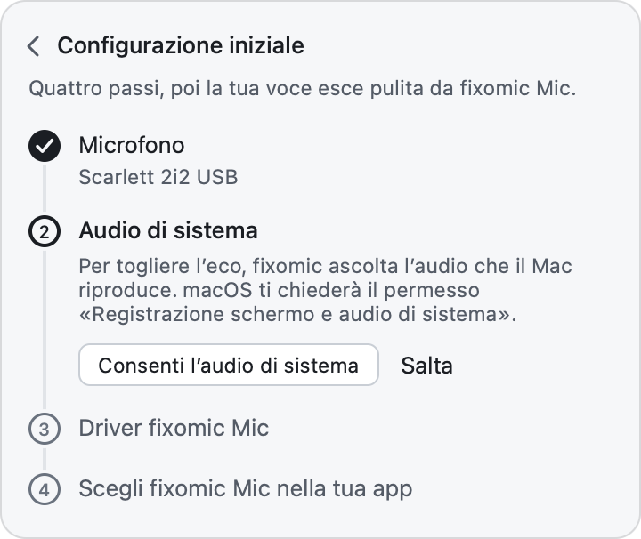
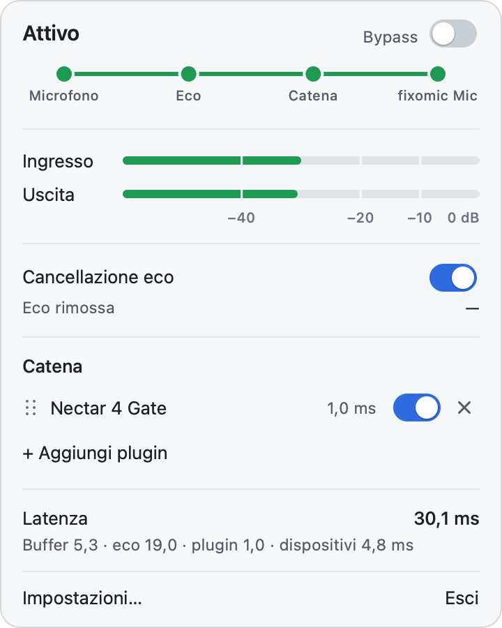
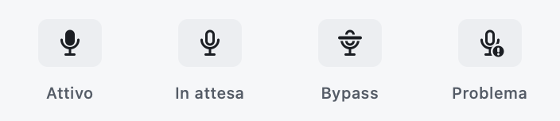
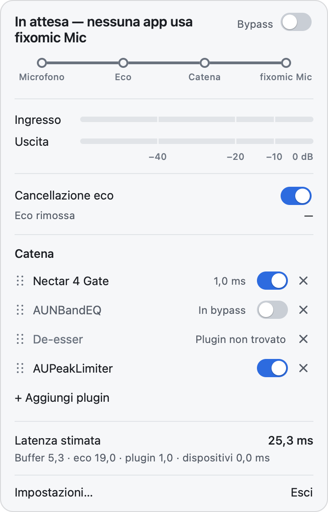
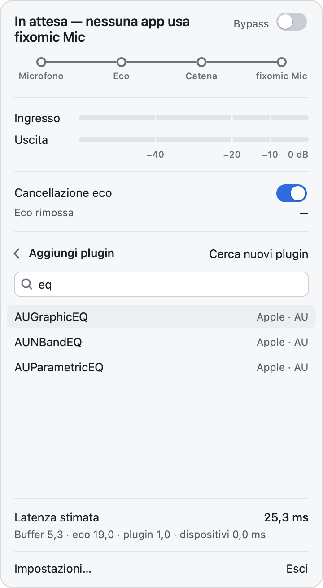
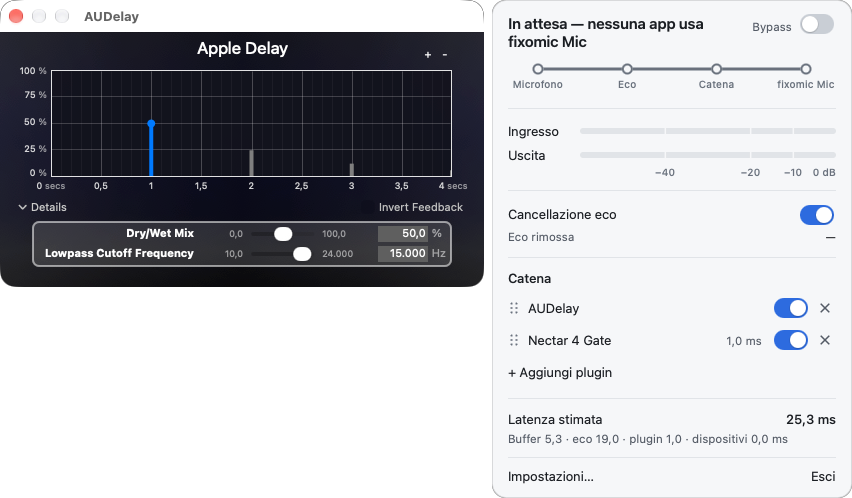
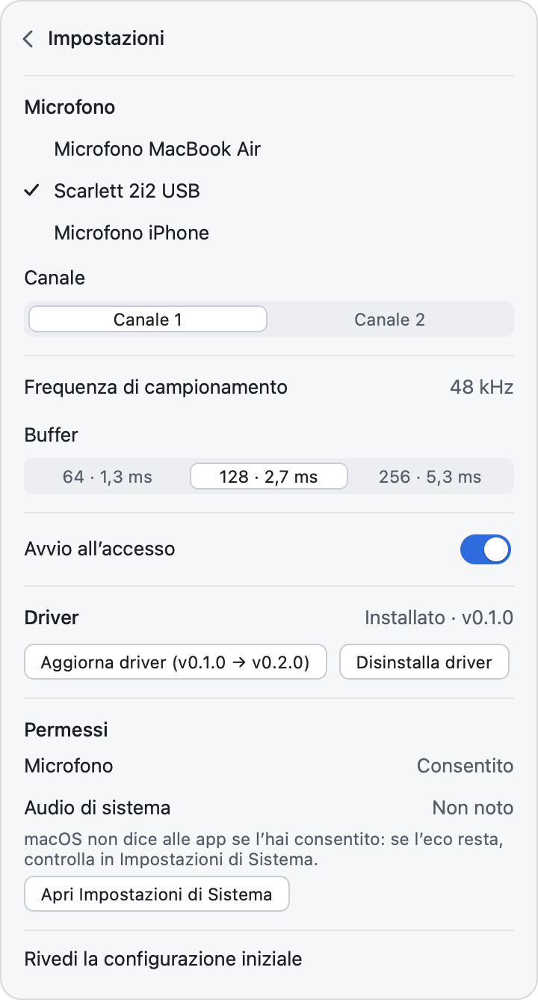
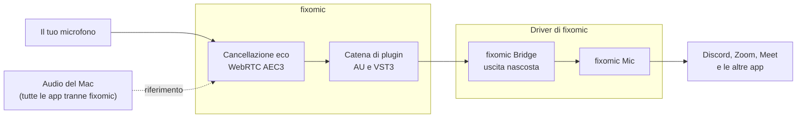

# Guida all'uso di fixomic

*English version: [guide.md](guide.md)*

fixomic è un'app per la barra dei menu di macOS. Prende la voce dal tuo microfono, toglie l'eco di
quello che il Mac sta riproducendo, la fa passare nei plugin che scegli e la offre alle altre app
come un microfono in più, **fixomic Mic**. In Discord, Zoom o Meet scegli fixomic Mic al posto del
solito microfono, e gli altri sentono solo la tua voce.

L'interfaccia di fixomic è in italiano. In questa guida i nomi dei pulsanti e i messaggi sono
scritti come li mostra l'app.

## Indice

- [Prima di iniziare](#prima-di-iniziare)
- [Installare fixomic](#installare-fixomic)
- [La configurazione iniziale](#la-configurazione-iniziale): i permessi e il driver
- [Scegliere fixomic Mic nelle app](#scegliere-fixomic-mic-nelle-app): Discord, Zoom, Teams, Meet, OBS, FaceTime
- [Il pannello](#il-pannello)
- [I plugin](#i-plugin)
- [Impostazioni](#impostazioni)
- [Il menu dell'icona](#il-menu-dellicona)
- [Come funziona](#come-funziona)
- [Privacy](#privacy)
- [Aggiornare fixomic](#aggiornare-fixomic)
- [Problemi e domande frequenti](#problemi-e-domande-frequenti)
- [Disinstallare](#disinstallare)

## Prima di iniziare

Ti servono:

- un Mac con macOS 14.4 o successivo, con Apple Silicon o Intel;
- un microfono che lavori a 48 kHz: quello del Mac, uno USB o uno collegato al jack vanno quasi
  sempre bene. I microfoni delle cuffie Bluetooth di solito no (vedi
  [Cuffie e microfoni Bluetooth](#cuffie-e-microfoni-bluetooth));
- la password di amministratore del Mac, una volta, per installare il driver.

fixomic è pensato per chi usa cuffie o un headset. Quello che ascolti può rientrare nel microfono,
per diafonia elettrica sul jack combo o perché il suono esce dai padiglioni, e così gli altri in
chiamata sentono il loro stesso audio o i video che stai guardando. fixomic funziona anche con gli
altoparlanti del Mac, ma non è regolato per quel caso.

## Installare fixomic

1. Apri la pagina delle [release](https://github.com/ManoloZocco/fixomic/releases/latest) e scarica
   `fixomic-<versione>.zip`.

   Se vuoi controllare che il file sia integro, scarica nella stessa cartella anche
   `fixomic-<versione>.zip.sha256` e, dal Terminale, in quella cartella scrivi:

   ```sh
   shasum -a 256 -c fixomic-<versione>.zip.sha256
   ```

   La risposta deve essere `fixomic-<versione>.zip: OK`.
2. Fai doppio clic sullo zip e trascina **fixomic.app** nella cartella **Applicazioni**.
3. Apri fixomic. La prima volta macOS la blocca: vedi qui sotto.

Lo stesso zip va bene per i Mac con Apple Silicon e per quelli con Intel.

### Aprire un'app non notarizzata

fixomic ha una firma *ad-hoc*: è firmata, ma non da uno sviluppatore registrato presso Apple, e
Apple non l'ha notarizzata. Per questo, la prima volta, macOS dice che non può verificarla e non la
apre. Il codice sorgente è tutto in questo repository, e puoi anche compilarlo da te (vedi il
[README](../README.md#compilare-dai-sorgenti)).

Per aprirla, scegli uno di questi modi. Basta farlo una volta.

- **macOS 14:** nel Finder, clic destro (o Ctrl-clic) su fixomic.app → **Apri**, poi ancora **Apri**
  nella finestra che compare.
- **macOS 15 e successivi:** prova ad aprirla e chiudi l'avviso. Poi vai in **Impostazioni di
  Sistema → Privacy e sicurezza** e scorri fino in fondo: accanto al messaggio su fixomic c'è
  **Apri comunque**. Fai clic, conferma e, se te la chiede, inserisci la password. Il pulsante resta
  disponibile per circa un'ora dopo il tentativo.
- **Dal Terminale**, con qualsiasi versione di macOS:

  ```sh
  xattr -dr com.apple.quarantine /Applications/fixomic.app
  ```

  Il comando toglie a fixomic il segno di "scaricato da Internet", e macOS non la blocca più.

Quando fixomic si apre, nella barra dei menu compare la sua icona, un microfono. Nel Dock non c'è
nessuna icona: fixomic vive solo nella barra dei menu.

## La configurazione iniziale

Al primo avvio il pannello si apre da solo sotto l'icona, con la **Configurazione iniziale**:
*Quattro passi, poi la tua voce esce pulita da fixomic Mic.*

<picture>
  <source media="(prefers-color-scheme: dark)" srcset="screenshots/onboarding-dark.png">
  
</picture>

Il passo aperto è in grassetto, quelli già fatti hanno un segno di spunta. Con **Salta** passi al
successivo e ci torni dopo.

1. **Microfono.** Fai clic su **Consenti l’accesso al microfono** e, nella richiesta di macOS,
   consenti. Poi, sotto *Scegli il microfono da usare.*, fai clic sul microfono che vuoi usare.
2. **Audio di sistema.** Fai clic su **Consenti l’audio di sistema**: macOS chiede il permesso
   *Registrazione schermo e audio di sistema*. Consentilo. Se la richiesta non compare, la guida
   dice *La richiesta non è riuscita: riprova.*
3. **Driver fixomic Mic.** Fai clic su **Installa driver** e inserisci la password di
   amministratore. Mentre Core Audio si riavvia, l'audio del Mac si ferma per un attimo.
4. **Scegli fixomic Mic nella tua app.** Apri Discord, o l'app che usi, e scegli fixomic Mic come
   microfono (vedi [Scegliere fixomic Mic nelle app](#scegliere-fixomic-mic-nelle-app)). Poi fai
   clic su **Fine**.

Se un permesso è stato negato, il passo mostra *Accesso negato* e il pulsante **Apri Impostazioni di
Sistema**, che ti porta alla pagina giusta.

Mentre la guida è aperta, il pannello non si chiude, anche quando rispondi alle richieste di macOS
o passi a Impostazioni di Sistema. Per chiuderla usa la freccia in alto a sinistra o il tasto Esc.
Se la chiudi prima di **Fine**, il pannello mostra *La configurazione iniziale non è completa.* con
il pulsante **Completa la configurazione**. Puoi rivederla quando vuoi da **Impostazioni… → Rivedi
la configurazione iniziale**.

### I permessi

fixomic chiede due permessi a macOS:

| Permesso | A cosa serve | Senza |
|---|---|---|
| **Microfono** | Leggere la tua voce dal microfono che scegli. | fixomic non può lavorare: fixomic Mic resta in silenzio. |
| **Registrazione schermo e audio di sistema** | Ascoltare quello che il Mac riproduce, per riconoscerlo nel microfono e toglierlo. | Tutto il resto funziona, ma l'eco non viene tolta. |

Il nome del secondo permesso spaventa un po', perché macOS usa lo stesso permesso per lo schermo e
per l'audio. fixomic **non** cattura lo schermo. L'audio del Mac gli serve solo come riferimento per
la cancellazione dell'eco: non lo registra, non lo salva, non lo manda alle altre app e non lo
modifica (quello che senti resta identico). Il riferimento esclude l'audio di fixomic stesso.

macOS non dice alle app se il permesso per l'audio di sistema è stato concesso. Per questo in
**Impostazioni…**, accanto a *Audio di sistema*, può comparire *Non noto*: è normale. Se il Mac sta
riproducendo audio e fixomic riceve solo silenzio, fixomic te lo segnala (vedi
[L'eco si sente ancora](#leco-si-sente-ancora)).

Se hai negato un permesso, attivalo in **Impostazioni di Sistema → Privacy e sicurezza →
Microfono**, oppure **→ Registrazione schermo e audio di sistema**. Il pulsante **Apri Impostazioni
di Sistema**, nella guida o in **Impostazioni…**, ti porta lì.

### Il driver

fixomic Mic è un dispositivo audio creato da un piccolo driver, incluso nell'app e derivato da
[BlackHole](https://github.com/ExistentialAudio/BlackHole). Il driver crea due dispositivi:

- **fixomic Mic**, un ingresso che tutte le app vedono come un microfono;
- **fixomic Bridge**, un'uscita nascosta in cui fixomic scrive la voce elaborata.

Quello che fixomic scrive in fixomic Bridge esce da fixomic Mic, senza ritardo aggiunto. Il driver
è caricato da Core Audio, il servizio audio di macOS: non è un'estensione del kernel. Quando fixomic
non è aperto, fixomic Mic dà silenzio.

L'installazione chiede la password di amministratore perché il driver va copiato in
`/Library/Audio/Plug-Ins/HAL/fixomic.driver`. Poi Core Audio si riavvia, e l'audio del Mac si ferma
per un attimo. Prima di installarlo, fixomic controlla che la firma del driver incluso sia integra.

Il driver si installa dalla guida o da **Impostazioni… → Driver**. Lì trovi anche **Aggiorna
driver**, quando una nuova versione di fixomic ne contiene uno più recente, e **Disinstalla
driver**.

## Scegliere fixomic Mic nelle app

In ogni app la regola è la stessa: nelle impostazioni audio, come microfono (o ingresso) scegli
**fixomic Mic**. L'uscita, cioè le cuffie o gli altoparlanti, non cambia.

fixomic si accende da solo quando un'app inizia a usare fixomic Mic. Il pannello passa da *In attesa
— nessuna app usa fixomic Mic* ad *Avvio…* e poi ad *Attivo*, di solito in meno di un secondo; nel
frattempo fixomic Mic dà silenzio, mai rumore. Circa 3 secondi dopo che l'ultima app ha smesso,
fixomic chiude il microfono e torna *In attesa*.

Scegli fixomic Mic per nome, non "Predefinito" o "Come il sistema": così l'app non cambia microfono
da sola quando colleghi o stacchi qualcosa.

I nomi dei menu delle altre app cambiano con le versioni e con la lingua. Se non trovi una voce,
cerca le impostazioni dell'audio o della voce dell'app.

### Discord

**Impostazioni utente** (l'ingranaggio in basso a sinistra) → **Voce e video** → **Dispositivo di
input** → **fixomic Mic**.

Nella stessa pagina spegni la cancellazione dell'eco e la soppressione del rumore di Discord.
fixomic toglie già l'eco, e due cancellazioni una dopo l'altra possono tagliare la voce quando parli
sopra l'audio. Se nella catena hai un compressore o Nectar, spegni anche il controllo automatico del
guadagno di Discord.

### Zoom

**Impostazioni** → **Audio** → **Microfono** → **fixomic Mic**. Durante una riunione lo cambi anche
dalla freccia accanto al pulsante del microfono. Zoom regola da solo il livello del microfono, ma su
fixomic Mic non ha effetto (vedi
[Il volume di fixomic Mic non cambia nulla](#il-volume-di-fixomic-mic-non-cambia-nulla)).

### Microsoft Teams

**Impostazioni e altro** (i tre puntini in alto) → **Impostazioni** → **Dispositivi** →
**Microfono** → **fixomic Mic**. Durante una riunione lo trovi tra le impostazioni dei dispositivi
della riunione.

### Google Meet, nel browser

Prima di entrare, apri il menu del microfono sotto l'anteprima e scegli fixomic Mic. Durante la
riunione: **Altre opzioni** (i tre puntini) → **Impostazioni** → **Audio** → **Microfono**. Il
browser deve avere il permesso per il microfono, sia per il sito di Meet sia in **Impostazioni di
Sistema → Privacy e sicurezza → Microfono**.

### OBS Studio

Nelle impostazioni di OBS, sezione **Audio**, scegli fixomic Mic come microfono; oppure aggiungi
alla scena una fonte di ingresso audio e scegli fixomic Mic come dispositivo. OBS cattura l'audio
del Mac con una sua fonte a parte: fixomic toglie quell'audio solo dalla tua voce, non dalla
registrazione.

### FaceTime

Nella barra dei menu apri **Video** e scegli **fixomic Mic** nell'elenco dei microfoni. FaceTime usa
l'elaborazione vocale di macOS, che aggiunge la sua riduzione del rumore e abbassa l'altro audio del
Mac durante la chiamata: la voce può arrivare un po' più bassa.

### Giochi e app senza scelta del microfono

Alcune app usano sempre l'ingresso predefinito del Mac. Per loro scegli fixomic Mic in
**Impostazioni di Sistema → Suono → Ingresso**. Da quel momento anche le altre app che seguono
l'ingresso predefinito useranno fixomic Mic.

## Il pannello

Fai clic sull'icona di fixomic nella barra dei menu: il pannello si apre sotto l'icona. Si chiude
con un altro clic sull'icona, con il tasto Esc, o con un clic su un'altra app o sulla scrivania.
Resta aperto mentre lavori nelle finestre dei plugin di fixomic (vedi
[Aprire la finestra di un plugin](#aprire-la-finestra-di-un-plugin)). Se lo schermo è basso, il
pannello scorre con il trackpad o la rotella.

Esc torna indietro di un passo alla volta: annulla un trascinamento in corso, chiude la ricerca dei
plugin, le impostazioni o la guida, e alla fine chiude il pannello.

<picture>
  <source media="(prefers-color-scheme: dark)" srcset="screenshots/panel-dark.png">
  
</picture>

Dall'alto in basso:

### Lo stato e il bypass

In alto c'è una frase che dice cosa sta facendo fixomic.

| Stato | Che cosa vuol dire |
|---|---|
| *In attesa — nessuna app usa fixomic Mic* | Nessuna app sta usando fixomic Mic, e fixomic non apre il microfono. È lo stato normale fuori dalle chiamate. |
| *Avvio…* | Un'app ha iniziato a usare fixomic Mic e fixomic sta aprendo il microfono. |
| *Attivo* | La tua voce passa da fixomic e arriva alle app. |
| *Bypass — audio non elaborato* | Il bypass globale è acceso: le app ricevono il microfono così com'è. |
| *In attesa del permesso per il microfono*, *In attesa del permesso per l'audio di sistema* | macOS aspetta la tua risposta a una richiesta di permesso. |
| *Microfono non collegato — fixomic Mic è in silenzio* | Il microfono scelto è scollegato. Quando torna, fixomic riparte da solo. |
| *Nessun microfono scelto — fixomic Mic è in silenzio* | Scegline uno in **Impostazioni…**. |
| *Driver non installato* | Installa il driver da **Impostazioni… → Driver**. |
| *Questo microfono non supporta 48 kHz* | Scegli un altro microfono (vedi [Cuffie e microfoni Bluetooth](#cuffie-e-microfoni-bluetooth)). |
| *Errore — …* | Qualcosa non è andato, e il testo dice che cosa. Per esempio: *Errore — Permesso microfono negato: abilitalo in Impostazioni di Sistema → Privacy e sicurezza → Microfono*. |

fixomic non passa mai da solo a un altro microfono. Se il tuo si scollega, le app ricevono silenzio,
non il microfono del Mac.

Accanto alla frase c'è l'interruttore **Bypass**. Acceso, le app ricevono il microfono crudo, senza
cancellazione dell'eco e senza plugin: serve per confrontare, o in emergenza se un plugin dà
problemi. Intanto la cancellazione dell'eco e la catena restano visibili, più chiare, e puoi
continuare a regolarle.

### Il percorso della voce

Sotto lo stato c'è una linea con quattro tappe: **Microfono**, **Eco**, **Catena** e **fixomic
Mic**.

- Un pallino pieno vuol dire che la tappa sta lavorando.
- Un cerchio vuoto vuol dire che è ferma o saltata: per esempio **Eco** con la cancellazione
  spenta, o **Catena** senza plugin attivi.
- Un pallino rosso con una barra vuol dire che lì c'è un problema: il microfono manca, o il driver
  non è installato.

### Gli avvisi

Sotto il percorso possono comparire avvisi su fondo colorato. Per esempio, quando l'audio di
sistema non arriva (*Permesso audio di sistema negato: la cancellazione dell'eco è disattivata. …*),
o quando un plugin non si è caricato all'avvio. Alcuni avvisi hanno il pulsante **Apri
Impostazioni**, che apre la pagina giusta di Impostazioni di Sistema. Se gli avvisi all'avvio sono
più di due, sono riuniti in uno solo: *N avvisi all’avvio: …*

### I livelli

**Ingresso** è il livello del microfono. **Uscita** è quello che esce da fixomic Mic, dopo la
cancellazione dell'eco e i plugin. La scala va da −60 dB (barra vuota) a 0 dB, con le tacche a
−40, −20 e −10. Se una barra diventa rossa, il segnale è quasi al massimo (sopra −1 dB): abbassa il
guadagno del microfono o regola i plugin. Le barre si muovono solo quando fixomic è *Attivo*.

### Cancellazione eco

L'interruttore **Cancellazione eco** accende e spegne la cancellazione dell'eco. Se le tue cuffie
non rientrano nel microfono, spegnila: la latenza scende di circa 19 ms.

**Eco rimossa** è una stima, in dB, di quanto la cancellazione sta abbassando l'eco. Mostra *—*
quando non c'è nulla da misurare: fixomic in attesa, cancellazione spenta o bypass acceso. È
un'indicazione, non una misura precisa, e non può salire molto oltre la distanza tra l'eco e il
rumore della stanza. Nelle prove di sviluppo, con l'eco abbassata di 31,6 dB, il pannello mostrava
tra 6 e 12 dB.

### La catena

L'elenco dei plugin che trattano la tua voce, nell'ordine in cui la elaborano, dall'alto in basso.
È spiegata in [I plugin](#i-plugin).

### La latenza

**Latenza** è il ritardo totale con cui la tua voce arriva alle app. Sotto c'è il dettaglio,
*Buffer · eco · plugin · dispositivi*, in millisecondi. Quando fixomic è in attesa la riga si chiama
**Latenza stimata**, e i dispositivi contano 0: la loro latenza si conosce solo a microfono aperto.
Le cifre e da dove vengono sono nel [README](../README.md#latenza).

### In fondo

**Impostazioni…** apre le impostazioni nel pannello stesso (vedi [Impostazioni](#impostazioni)).
**Esci** chiude fixomic: fixomic Mic resta tra i dispositivi, ma dà silenzio finché non riapri
fixomic.

### L'icona nella barra dei menu

L'icona mostra lo stato anche a pannello chiuso:

<picture>
  <source media="(prefers-color-scheme: dark)" srcset="screenshots/tray-dark.png">
  
</picture>

- **Attivo:** il microfono è pieno.
- **In attesa:** il microfono è vuoto.
- **Bypass:** una barra attraversa il microfono.
- **Problema:** un punto esclamativo in basso a destra. Il microfono manca, il driver non è
  installato, il microfono non supporta 48 kHz, o c'è un errore.

## I plugin

fixomic usa i plugin di effetti **Audio Unit** (AU) e **VST3** installati sul Mac: un gate, un
compressore, un equalizzatore, iZotope Nectar e così via. Gli strumenti virtuali non compaiono. I
plugin lavorano dopo la cancellazione dell'eco, nell'ordine della catena.

<picture>
  <source media="(prefers-color-scheme: dark)" srcset="screenshots/chain-dark.png">
  
</picture>

Ogni riga ha, da sinistra: la maniglia per trascinare (sei puntini), il nome, la latenza del plugin
(per esempio *1,0 ms*, se ne ha una), l'interruttore e la ×.

### Aggiungere un plugin

1. Fai clic su **+ Aggiungi plugin**, sotto la catena. Con la catena vuota il pannello dice
   *Nessun plugin: aggiungine uno per trattare la voce.*
2. Al posto della catena compare **Aggiungi plugin**, con un campo di ricerca. Scrivi una parte del
   nome o del produttore (*Cerca per nome o produttore*). Maiuscole e accenti non contano; se
   scrivi più parole, devono esserci tutte.
3. Fai clic sul plugin, oppure sceglilo con le frecce ↑ ↓ e premi Invio. Il plugin si aggiunge in
   fondo alla catena.

Ogni riga dell'elenco mostra il nome, il produttore e il formato, *AU* o *VST3*. Esc, o la freccia
in alto a sinistra, torna alla catena senza aggiungere nulla. Se un plugin non si carica, sotto
l'elenco compare *Impossibile caricare «nome».*

<picture>
  <source media="(prefers-color-scheme: dark)" srcset="screenshots/picker-dark.png">
  
</picture>

fixomic cerca i plugin installati a ogni avvio, in un processo separato, così un plugin difettoso
non può farlo chiudere. Se hai appena installato un plugin e non lo vedi, fai clic su **Cerca nuovi
plugin**: durante la ricerca compare *Scansione in corso…*.

### Aprire la finestra di un plugin

Fai clic sul nome del plugin. La sua finestra, l'editor, si apre accanto al pannello (di solito a
sinistra), e il pannello resta aperto. Così puoi regolare il plugin e intanto riordinare la catena
trascinando le righe. Se apri altri plugin, le loro finestre si dispongono a cascata, sempre accanto
al pannello. Un clic sul nome di un plugin già aperto riporta davanti la sua finestra, senza
spostarla.



Quando chiudi la finestra del plugin con il pulsante di chiusura, il pannello resta aperto con la
catena, e Esc lo chiude. Il pannello si chiude invece se fai clic su un'altra app o sulla scrivania;
le finestre dei plugin restano aperte finché non le chiudi.

Un plugin senza una finestra propria mostra l'elenco dei suoi parametri.

### Riordinare

L'ordine conta: per esempio, un gate va di solito prima di un compressore. Per spostare un plugin,
premi sulla sua riga (sulla maniglia a sinistra o sul nome) e trascinala: una linea mostra dove
andrà. Rilascia per spostarlo. Se rilasci lontano dalla catena, o premi Esc durante il
trascinamento, non cambia nulla. Il nuovo ordine vale subito, senza fermare l'audio.

### Mettere in bypass un plugin

L'interruttore sulla riga accende e spegne quel plugin. Spento, la riga dice *In bypass*: il plugin
non tocca la voce, ma resta nella catena con le sue regolazioni.

### Rimuovere un plugin

La × in fondo alla riga toglie il plugin dalla catena, e chiude la sua finestra se è aperta. Non
c'è conferma.

### Un plugin non trovato

Se un plugin della catena non si può caricare, per esempio perché lo hai disinstallato, la sua riga
resta in grigio con *Plugin non trovato*, senza interruttore, e non si apre. All'avvio un avviso
dice quale plugin non si è caricato e perché, per esempio *nome: non è stato possibile caricarlo*.
fixomic conserva le sue regolazioni: se reinstalli il plugin e riapri fixomic, torna com'era. Se non
ti serve più, toglilo con la ×.

### Salvataggio

La catena, l'ordine, i bypass e le regolazioni di ogni plugin si salvano da soli e tornano al
prossimo avvio.

## Impostazioni

Fai clic su **Impostazioni…** in fondo al pannello. La freccia in alto a sinistra, o Esc, torna al
pannello.

<picture>
  <source media="(prefers-color-scheme: dark)" srcset="screenshots/settings-dark.png">
  
</picture>

- **Microfono.** L'elenco dei microfoni collegati: fai clic su quello da usare (fixomic Mic non
  c'è). Se il microfono scelto è scollegato, resta nell'elenco come *nome — non collegato*. Se il
  microfono ha più ingressi, per esempio una scheda audio, sotto compare **Canale**: scegli quello
  a cui è collegato il microfono (*Canale 1*, *Canale 2*…). fixomic usa un solo canale.
- **Frequenza di campionamento.** Sempre *48 kHz*. Se il microfono scelto non la supporta, qui
  compare *Questo microfono non supporta 48 kHz*.
- **Buffer.** Quanti campioni fixomic elabora alla volta: *64 · 1,3 ms*, *128 · 2,7 ms* (il
  predefinito) o *256 · 5,3 ms*. Un buffer più piccolo riduce la latenza ma chiede più lavoro al
  Mac; uno più grande dà più margine se senti click o interruzioni. Il cambio vale subito, e le app
  ricevono meno di mezzo secondo di silenzio.
- **Avvio all’accesso.** Acceso, fixomic si apre da solo quando accedi al Mac. Se macOS vuole la
  tua approvazione, compare *Approva fixomic in Impostazioni di Sistema → Generali → Elementi
  login*.
- **Driver.** Lo stato (*Non installato*, oppure *Installato · v* seguito dalla versione) e i
  pulsanti **Installa driver**, **Aggiorna driver** e **Disinstalla driver**. La disinstallazione
  chiede conferma (*Disinstallare il driver? fixomic Mic sparirà da tutte le app finché non lo
  reinstalli.*: **Disinstalla** o **Annulla**) e poi la password. Durante l'operazione compare
  *Operazione in corso…*, alla fine *Driver installato.*, *Driver aggiornato.* o *Driver
  disinstallato.*
- **Permessi.** Lo stato dei due permessi. Per il microfono: *Consentito*, *Negato* o *Non ancora
  chiesto*. Per l'audio di sistema: *Consentito*, *Negato*, *Non noto* o *Da controllare*, perché
  macOS non lo rivela alle app. I pulsanti **Consenti il microfono** e **Apri Impostazioni di
  Sistema** ti aiutano a sistemarli.
- **Rivedi la configurazione iniziale** riapre la guida del primo avvio.

## Il menu dell'icona

Con un clic destro (o Ctrl-clic) sull'icona di fixomic si apre un piccolo menu: in alto lo stato
attuale, lo stesso testo del pannello, solo da leggere; sotto, **Esci**.

## Come funziona



1. **Il microfono.** fixomic legge il microfono che hai scelto, a 48 kHz.
2. **La cancellazione dell'eco.** Nello stesso momento fixomic ascolta quello che il Mac riproduce,
   con un *process tap* di Core Audio: è il riferimento. WebRTC AEC3, il motore di cancellazione
   dell'eco di WebRTC, cerca quel suono nel microfono e lo toglie, lasciando la tua voce. Il
   riferimento comprende anche le voci degli altri in chiamata: rientrano nel microfono come il
   resto, e vanno tolte anche quelle.
3. **La catena di plugin.** La voce pulita passa nei plugin, nell'ordine della catena. La
   cancellazione viene prima dei plugin perché gate, compressori e saturatori cambiano il suono in
   modo non lineare, e dopo di loro l'eco non si potrebbe più riconoscere.
4. **Il driver.** fixomic scrive il risultato in fixomic Bridge, l'uscita nascosta del driver, e il
   driver lo fa uscire da fixomic Mic.
5. **Le app.** Discord, Zoom e le altre leggono fixomic Mic come un microfono qualsiasi.

Con il **Bypass** acceso, la voce va dal microfono direttamente a fixomic Bridge, senza
cancellazione e senza plugin.

**Solo quando serve.** Il driver avvisa fixomic quando un'app inizia o smette di usare fixomic Mic.
Solo allora fixomic apre il microfono e il riferimento. I plugin sono già caricati, quindi di
solito è pronto in meno di un secondo. Quando l'ultima app smette, fixomic aspetta circa 3 secondi
(così un'app che chiude e riapre subito il microfono non fa ripartire tutto) e poi chiude il
microfono.

**Orologi diversi.** Il microfono, l'uscita del Mac e fixomic Mic possono andare a velocità
leggermente diverse. fixomic compensa la differenza, così il ritardo non cresce, anche dopo ore.

## Privacy

- **Tutto resta sul Mac.** L'audio viene elaborato solo sul tuo Mac. fixomic non contiene codice che
  si collega a Internet: nessun account, nessuna statistica d'uso, nessun controllo degli
  aggiornamenti. Le librerie di JUCE incluse nell'app contengono funzioni di rete, ma fixomic non le
  usa.
- **Nessuna registrazione.** fixomic non registra e non salva audio. La tua voce va solo a fixomic
  Mic, cioè alle app che scegli tu. L'audio del Mac serve solo da riferimento per la cancellazione
  dell'eco.
- **Cosa resta sul disco.** fixomic salva solo le impostazioni (la catena, le regolazioni dei
  plugin, il microfono scelto) e l'elenco dei plugin installati, in
  `~/Library/Application Support/fixomic`.
- **I plugin sono di terze parti** e girano dentro fixomic. Alcuni si collegano a Internet per conto
  loro, per esempio per attivare la licenza: dipende dal plugin, non da fixomic.
- Le app in cui scegli fixomic Mic, come Discord o Zoom, mandano la tua voce in rete come fanno con
  qualsiasi microfono.

## Aggiornare fixomic

1. Esci da fixomic: **Esci** nel pannello o nel menu dell'icona.
2. Scarica la nuova versione dalle
   [release](https://github.com/ManoloZocco/fixomic/releases/latest) e sostituisci fixomic.app in
   **Applicazioni**.
3. Aprila come la prima volta (vedi [Aprire un'app non notarizzata](#aprire-unapp-non-notarizzata)).
4. Concedi di nuovo i permessi quando macOS li chiede (vedi
   [I permessi vengono chiesti di nuovo dopo un aggiornamento](#i-permessi-vengono-chiesti-di-nuovo-dopo-un-aggiornamento)).
5. Se in **Impostazioni… → Driver** compare **Aggiorna driver**, fai clic e inserisci la password.

La catena e le impostazioni restano.

## Problemi e domande frequenti

### L'eco si sente ancora

- Controlla che **Cancellazione eco** sia accesa e che, mentre fixomic è *Attivo*, la tappa **Eco**
  del percorso abbia il pallino pieno.
- Se c'è un avviso sull'audio di sistema, fixomic non riceve il riferimento. Gli avvisi possibili
  sono *Permesso audio di sistema negato: …*, *Audio di sistema non disponibile: …* e *fixomic
  riceve solo silenzio dall'audio di sistema mentre il Mac riproduce audio. …*. Apri **Impostazioni
  di Sistema → Privacy e sicurezza → Registrazione schermo e audio di sistema** (il pulsante **Apri
  Impostazioni** dell'avviso ti porta lì) e abilita fixomic. L'ultimo avviso può comparire anche in
  una chiamata in cui nessuno parla: se l'eco non c'è, puoi ignorarlo.
- fixomic toglie solo quello che suona **sul Mac**. Un telefono, una TV o un altro computer nella
  stanza non sono nel riferimento.
- Nell'app di chiamata spegni, se puoi, la sua cancellazione dell'eco e la soppressione del rumore
  (in Discord si può).
- Con gli altoparlanti al posto delle cuffie la cancellazione funziona, ma fixomic non è regolato
  per quel caso: abbassa il volume, o usa le cuffie.
- Quando parli sopra l'audio può restare un filo di eco. È voluto: meglio un po' di eco che una voce
  tagliata.

### Gli altri non mi sentono

- Guarda la frase di stato. Se durante una chiamata dice *In attesa — nessuna app usa fixomic Mic*,
  l'app non sta usando fixomic Mic: controlla il microfono scelto nell'app.
- Per *Microfono non collegato…*, *Nessun microfono scelto…*, *Driver non installato* e *Questo
  microfono non supporta 48 kHz*, vedi la tabella in [Lo stato e il bypass](#lo-stato-e-il-bypass).
- Se **Ingresso** si muove ma **Uscita** no, un plugin sta tagliando la voce, per esempio un gate
  con la soglia troppo alta. Prova a metterlo in bypass, o accendi il **Bypass** globale per
  confronto.
- Se **Uscita** si muove ma le app non ricevono nulla, fixomic Mic può essere in muto. Apri
  *Configurazione Audio MIDI* (in **Applicazioni → Utility**), seleziona fixomic Mic e deseleziona
  *Muto*. Anche le utility che regolano il volume di ogni singola app (per esempio SoundSource)
  possono silenziare l'audio che fixomic manda a fixomic Mic: escludi fixomic da quelle utility.
- Controlla che l'app di chiamata non ti abbia messo in muto, e che fixomic sia aperto: senza
  fixomic, fixomic Mic dà silenzio.

### fixomic Mic non compare nelle app

Il driver non è installato, e il pannello dice *Driver non installato*. Installalo da
**Impostazioni… → Driver**. Se fixomic Mic ancora non compare in un'app già aperta, chiudila e
riaprila.

### Cuffie e microfoni Bluetooth

fixomic lavora solo a 48 kHz. Quasi tutte le cuffie Bluetooth, quando il loro microfono è in uso,
passano al profilo per le chiamate (HFP), che lavora a 16 o 24 kHz; allora fixomic mostra *Questo
microfono non supporta 48 kHz*. Usa le cuffie Bluetooth solo per ascoltare, e come microfono quello
del Mac, uno USB o uno sul jack.

### La latenza è alta

- La cancellazione dell'eco aggiunge da sola circa 19 ms. Se le tue cuffie non rientrano nel
  microfono, tienila spenta. Per saperlo, spegnila e chiedi a chi ti ascolta se sente il tuo audio.
- Con il buffer 64 la latenza scende di circa 2,7 ms rispetto a 128.
- Guarda i millisecondi accanto a ogni plugin: alcuni, per esempio quelli che "guardano avanti" nel
  segnale, aggiungono parecchio.
- Le cifre complete sono nel [README](../README.md#latenza). Per confronto, Discord da solo aggiunge
  circa 20 ms di codifica, più la rete.

### Il pallino arancione

Il pallino arancione nella barra dei menu vuol dire che un'app sta usando un microfono. fixomic apre
il microfono solo mentre un'app usa fixomic Mic: il pallino si accende all'inizio della chiamata e
si spegne circa 3 secondi dopo che l'ultima app ha smesso. Se resta acceso, apri il Centro di
Controllo: in alto vedi quali app stanno usando il microfono. Di solito è un'app di chiamata ancora
in un canale vocale o in una riunione.

### Un plugin fa chiudere fixomic

- **Durante la ricerca dei plugin.** La ricerca gira in un processo separato. Se un plugin si blocca
  o va in crash, fixomic lo mette in una lista nera e continua con gli altri; quel plugin non
  compare più tra quelli da aggiungere. Per riprovarlo, per esempio dopo averlo aggiornato, esci da
  fixomic, cancella la cache dei plugin e riapri fixomic, che li analizza di nuovo tutti:

  ```sh
  rm ~/Library/Application\ Support/fixomic/plugins.xml
  ```

- **All'avvio.** Se un plugin della catena fa chiudere fixomic mentre si carica, al lancio
  successivo fixomic se ne accorge e carica la catena senza plugin. Compare l'avviso *L’ultimo avvio
  si è interrotto caricando i plugin: la catena è stata caricata senza plugin. Togli quello che dà
  problemi: al prossimo avvio fixomic proverà di nuovo a caricarli.* Le righe dicono *Plugin non
  trovato*, ma le regolazioni sono conservate. Togli con la × il plugin sospetto, di solito l'ultimo
  aggiunto o aggiornato, poi esci e riapri fixomic: gli altri tornano. Così fixomic non resta
  bloccato in un ciclo di chiusure, anche con l'avvio all'accesso.
- **Durante l'uso.** I plugin girano dentro fixomic: se uno va in crash mentre lo usi, fixomic si
  chiude e fixomic Mic dà silenzio. Riapri fixomic; se succede di nuovo, togli quel plugin.

### I permessi vengono chiesti di nuovo dopo un aggiornamento

Con questa versione di fixomic è normale. L'app ha una firma ad-hoc, non quella di uno sviluppatore
registrato presso Apple: per macOS ogni versione è un'app diversa, e i permessi dati alla
precedente non valgono più. Concedili di nuovo.

Se in Impostazioni di Sistema fixomic risulta già abilitato ma si comporta come se non lo fosse,
azzera i suoi permessi dal Terminale e riapri fixomic, che li chiederà di nuovo:

```sh
tccutil reset All it.manolozocco.fixomic
```

### Il volume di fixomic Mic non cambia nulla

Il cursore del volume di fixomic Mic in Impostazioni di Sistema non ha effetto, di proposito: così
le app che regolano da sole il livello del microfono, come Zoom, non possono abbassare la tua voce.
Il livello si regola con i plugin della catena, per esempio un guadagno, un compressore o Nectar.

## Disinstallare

1. Nel pannello: **Impostazioni… → Driver → Disinstalla driver**, conferma con **Disinstalla** e
   inserisci la password. fixomic Mic sparisce da tutte le app.
2. Se avevi acceso **Avvio all’accesso**, spegnilo.
3. Esci da fixomic (**Esci** nel pannello o nel menu dell'icona) e sposta fixomic.app nel Cestino.
4. Se vuoi, cancella anche le impostazioni (catena, plugin, microfono scelto) e i permessi:

   ```sh
   rm -rf ~/Library/Application\ Support/fixomic
   tccutil reset All it.manolozocco.fixomic
   ```

Se hai già cancellato l'app e il driver è rimasto, toglilo dal Terminale:

```sh
sudo rm -rf /Library/Audio/Plug-Ins/HAL/fixomic.driver && sudo killall coreaudiod
```
