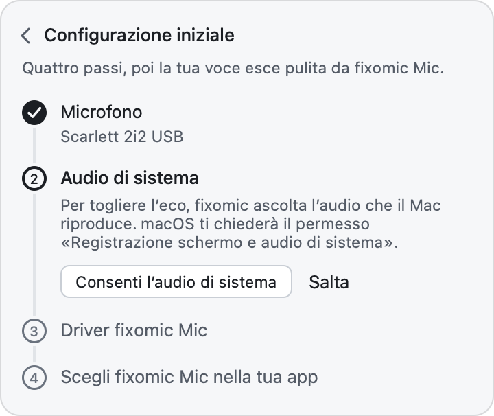
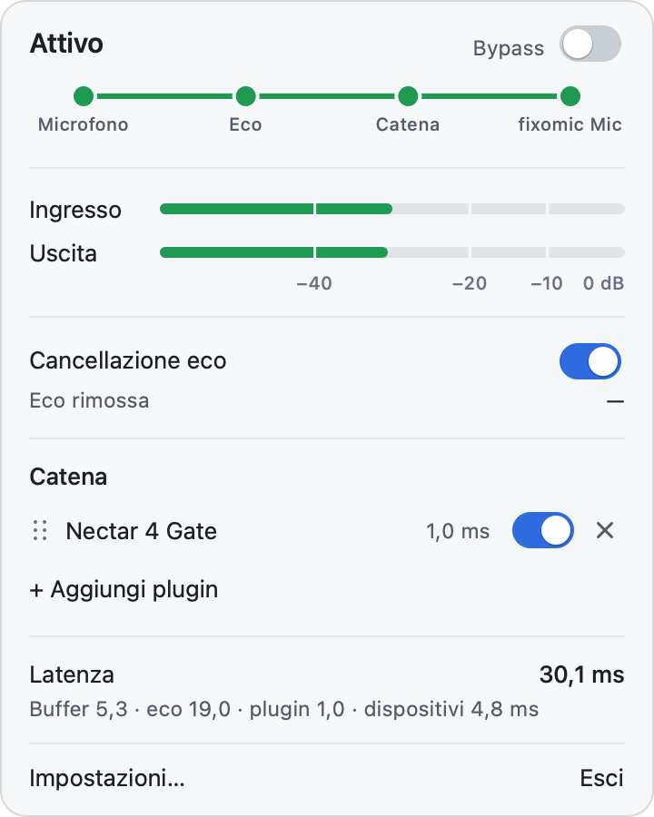
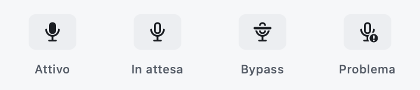
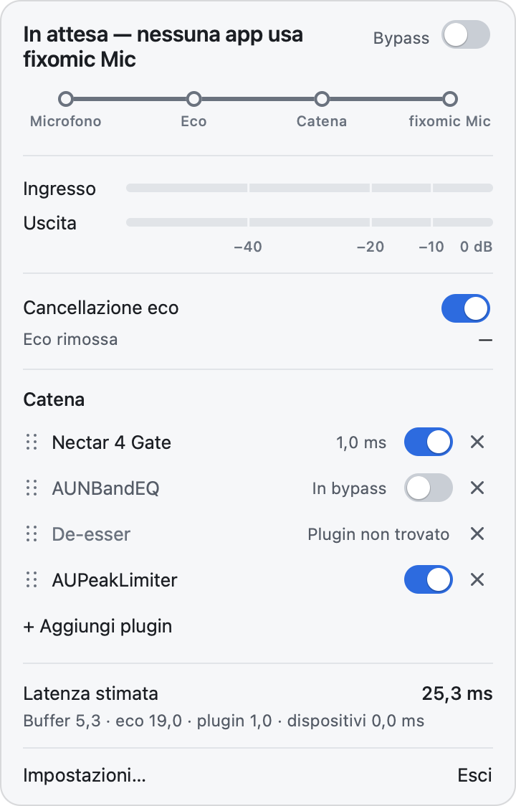
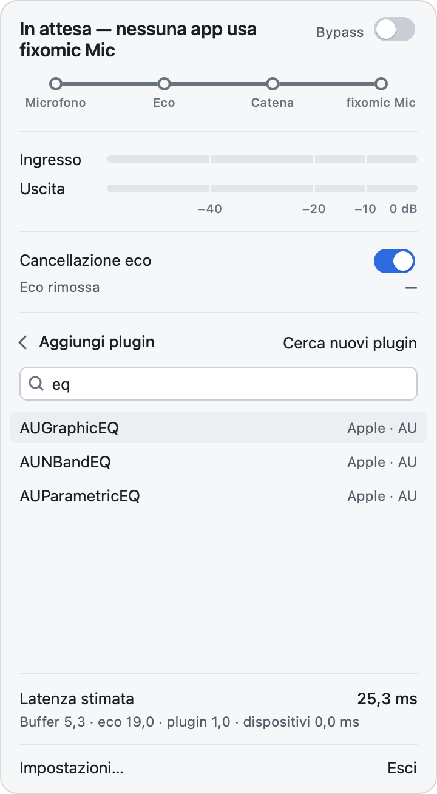
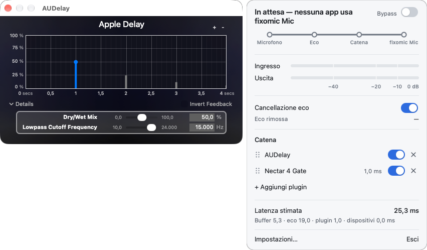
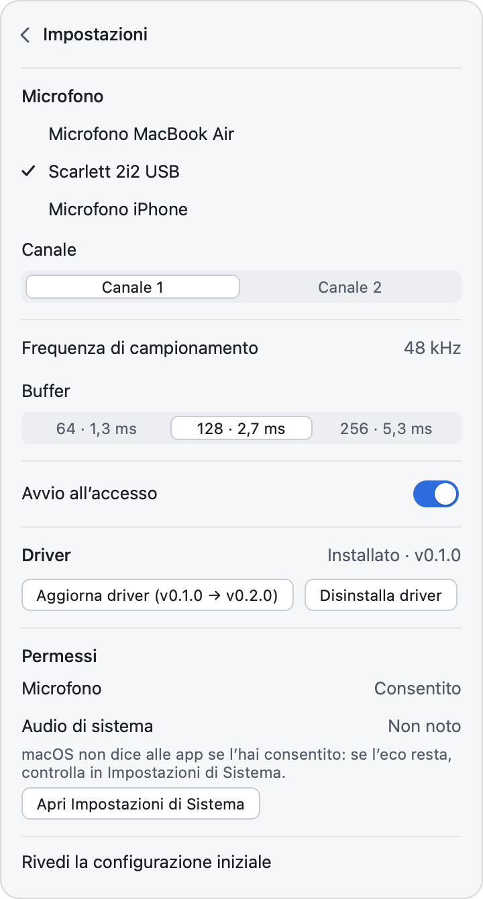
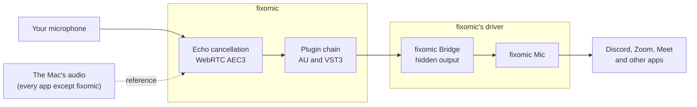

# fixomic user guide

*Versione italiana: [guida.md](guida.md)*

fixomic is a macOS menu-bar app. It takes your voice from your microphone, removes the echo of
whatever the Mac is playing, runs it through the plugins you choose, and offers it to other apps as
one more microphone, **fixomic Mic**. In Discord, Zoom or Meet you choose fixomic Mic instead of
your usual microphone, and the others hear only your voice.

fixomic's interface is in Italian. This guide quotes the buttons and messages exactly as the app
shows them, in italics or bold, followed by a translation in brackets where it helps.

## Contents

- [Before you start](#before-you-start)
- [Installing fixomic](#installing-fixomic)
- [The first-run guide](#the-first-run-guide): permissions and the driver
- [Choosing fixomic Mic in your apps](#choosing-fixomic-mic-in-your-apps): Discord, Zoom, Teams, Meet, OBS, FaceTime
- [The panel](#the-panel)
- [Plugins](#plugins)
- [Settings](#settings)
- [The icon's menu](#the-icons-menu)
- [How it works](#how-it-works)
- [Privacy](#privacy)
- [Updating fixomic](#updating-fixomic)
- [Troubleshooting and FAQ](#troubleshooting-and-faq)
- [Uninstalling](#uninstalling)

## Before you start

You need:

- a Mac with macOS 14.4 or later, with Apple Silicon or Intel;
- a microphone that works at 48 kHz: the Mac's own, a USB one or one on the jack almost always do.
  Bluetooth headset microphones usually do not (see
  [Bluetooth headsets and microphones](#bluetooth-headsets-and-microphones));
- the Mac's administrator password, once, to install the driver.

fixomic is made for people who use headphones or a headset. What you hear can leak into the
microphone, through electrical crosstalk on the combo jack or because the sound comes out of the ear
cups, and then the others on the call hear their own audio or the videos you are watching. fixomic
also works with the Mac's speakers, but it is not tuned for that case.

## Installing fixomic

1. Open the [releases](https://github.com/ManoloZocco/fixomic/releases/latest) page and download
   `fixomic-<version>.zip`.

   To check that the file is intact, also download `fixomic-<version>.zip.sha256` to the same
   folder and, in Terminal, in that folder, type:

   ```sh
   shasum -a 256 -c fixomic-<version>.zip.sha256
   ```

   The answer must be `fixomic-<version>.zip: OK`.
2. Double-click the zip and drag **fixomic.app** to the **Applications** folder.
3. Open fixomic. The first time, macOS blocks it: see below.

The same zip works on Macs with Apple Silicon and on Macs with Intel.

### Opening an app that is not notarised

fixomic has an *ad-hoc* signature: it is signed, but not by a developer registered with Apple, and
Apple has not notarised it. So, the first time, macOS says it cannot verify it and does not open it.
All of the source code is in this repository, and you can also build it yourself (see the
[README](../README.md#building-from-source)).

To open it, pick one of these ways. You only need to do it once.

- **macOS 14:** in the Finder, right-click (or Control-click) fixomic.app → **Open**, then **Open**
  again in the window that appears.
- **macOS 15 and later:** try to open it and close the warning. Then go to **System Settings →
  Privacy & Security** and scroll to the bottom: next to the message about fixomic there is **Open
  Anyway**. Click it, confirm and, if asked, enter your password. The button stays available for
  about an hour after the attempt.
- **From Terminal**, on any version of macOS:

  ```sh
  xattr -dr com.apple.quarantine /Applications/fixomic.app
  ```

  The command removes fixomic's "downloaded from the Internet" mark, and macOS no longer blocks it.

When fixomic opens, its icon, a microphone, appears in the menu bar. There is no Dock icon: fixomic
lives only in the menu bar.

## The first-run guide

On the first launch the panel opens by itself under the icon, with **Configurazione iniziale**
(initial setup): *Quattro passi, poi la tua voce esce pulita da fixomic Mic.* (four steps, then your
voice comes out clean from fixomic Mic).

<picture>
  <source media="(prefers-color-scheme: dark)" srcset="screenshots/onboarding-dark.png">
  
</picture>

The open step is in bold; the steps already done have a tick. **Salta** (skip) moves on to the next
step; you can come back later.

1. **Microfono** (microphone). Click **Consenti l’accesso al microfono** (allow microphone access)
   and allow it in the macOS prompt. Then, under *Scegli il microfono da usare.* (choose the
   microphone to use), click the microphone you want.
2. **Audio di sistema** (system audio). Click **Consenti l’audio di sistema** (allow system audio):
   macOS asks for the *Screen & System Audio Recording* permission. Allow it. If the prompt does not
   appear, the guide says *La richiesta non è riuscita: riprova.* (the request failed: try again).
3. **Driver fixomic Mic.** Click **Installa driver** (install driver) and enter the administrator
   password. While Core Audio restarts, the Mac's audio stops for a moment.
4. **Scegli fixomic Mic nella tua app** (choose fixomic Mic in your app). Open Discord, or the app
   you use, and choose fixomic Mic as the microphone (see
   [Choosing fixomic Mic in your apps](#choosing-fixomic-mic-in-your-apps)). Then click **Fine**
   (done).

If a permission was denied, the step shows *Accesso negato* (access denied) and the button **Apri
Impostazioni di Sistema** (open System Settings), which takes you to the right page.

While the guide is open, the panel does not close, even when you answer the macOS prompts or switch
to System Settings. To close it, use the arrow at the top left or the Esc key. If you close it before
**Fine**, the panel shows *La configurazione iniziale non è completa.* (the initial setup is not
complete) with the button **Completa la configurazione** (complete the setup). You can go through it
again at any time from **Impostazioni… → Rivedi la configurazione iniziale** (Settings → review the
initial setup).

### Permissions

fixomic asks macOS for two permissions:

| Permission | What it is for | Without it |
|---|---|---|
| **Microphone** | Reading your voice from the microphone you choose. | fixomic cannot work: fixomic Mic stays silent. |
| **Screen & System Audio Recording** | Listening to what the Mac plays, to recognise it in the microphone and remove it. | Everything else works, but echo is not removed. |

The name of the second permission sounds alarming, because macOS uses one permission for both the
screen and the audio. fixomic does **not** capture the screen. It uses the Mac's audio only as the
reference for echo cancellation: it does not record it, save it, send it to other apps or change it
(what you hear stays exactly the same). The reference leaves out fixomic's own audio.

macOS does not tell apps whether the system audio permission was granted. So in **Impostazioni…**,
next to *Audio di sistema*, you may see *Non noto* (unknown): that is normal. If the Mac is playing
audio and fixomic receives only silence, fixomic tells you (see
[I can still hear echo](#i-can-still-hear-echo)).

If you denied a permission, turn it on in **System Settings → Privacy & Security → Microphone**, or
**→ Screen & System Audio Recording**. The **Apri Impostazioni di Sistema** button, in the guide or
in **Impostazioni…**, takes you there.

### The driver

fixomic Mic is an audio device created by a small driver, which ships inside the app and is derived
from [BlackHole](https://github.com/ExistentialAudio/BlackHole). The driver creates two devices:

- **fixomic Mic**, an input that every app sees as a microphone;
- **fixomic Bridge**, a hidden output that fixomic writes the processed voice to.

Whatever fixomic writes to fixomic Bridge comes out of fixomic Mic, with no added delay. The driver
is loaded by Core Audio, the macOS audio service: it is not a kernel extension. When fixomic is not
open, fixomic Mic gives silence.

Installing it asks for the administrator password because the driver is copied to
`/Library/Audio/Plug-Ins/HAL/fixomic.driver`. Then Core Audio restarts, and the Mac's audio stops
for a moment. Before installing, fixomic checks that the signature of the bundled driver is intact.

You install the driver from the guide or from **Impostazioni… → Driver**. There you also find
**Aggiorna driver** (update driver), when a new fixomic version carries a newer driver, and
**Disinstalla driver** (uninstall driver).

## Choosing fixomic Mic in your apps

The rule is the same in every app: in its audio settings, choose **fixomic Mic** as the microphone
(or input). The output, your headphones or speakers, does not change.

fixomic turns on by itself when an app starts using fixomic Mic. The panel goes from *In attesa —
nessuna app usa fixomic Mic* (waiting, no app is using fixomic Mic) to *Avvio…* (starting) and then
to *Attivo* (active), usually in less than a second; meanwhile fixomic Mic gives silence, never
noise. About 3 seconds after the last app stops, fixomic closes the microphone and goes back to
*In attesa*.

Choose fixomic Mic by name, not "Default" or "Same as system": then the app does not switch
microphones on its own when you plug or unplug something.

Other apps' menu names change with their versions and languages. If you cannot find an item, look for
the app's audio or voice settings.

### Discord

**User Settings** (the gear at the bottom left) → **Voice & Video** → **Input Device** → **fixomic
Mic**.

On the same page, turn off Discord's echo cancellation and noise suppression. fixomic already removes
the echo, and two cancellations in a row can cut your voice when you talk over the audio. If your
chain has a compressor or Nectar, also turn off Discord's automatic gain control.

### Zoom

**Settings** → **Audio** → **Microphone** → **fixomic Mic**. During a meeting you can also change it
from the arrow next to the microphone button. Zoom adjusts the microphone level by itself, but that
has no effect on fixomic Mic (see
[fixomic Mic's volume changes nothing](#fixomic-mics-volume-changes-nothing)).

### Microsoft Teams

**Settings and more** (the three dots at the top) → **Settings** → **Devices** → **Microphone** →
**fixomic Mic**. During a meeting you find it in the meeting's device settings.

### Google Meet, in the browser

Before joining, open the microphone menu under the preview and choose fixomic Mic. During the
meeting: **More options** (the three dots) → **Settings** → **Audio** → **Microphone**. The browser
needs microphone permission, both for the Meet site and in **System Settings → Privacy & Security →
Microphone**.

### OBS Studio

In OBS's settings, **Audio** section, choose fixomic Mic as the microphone; or add an audio input
source to the scene and choose fixomic Mic as its device. OBS captures the Mac's audio with a
separate source of its own: fixomic removes that audio only from your voice, not from the recording.

### FaceTime

In the menu bar, open **Video** and choose **fixomic Mic** in the list of microphones. FaceTime uses
macOS voice processing, which adds its own noise reduction and lowers the Mac's other audio during
the call: your voice may arrive a little quieter.

### Games and apps without a microphone choice

Some apps always use the Mac's default input. For them, choose fixomic Mic in **System Settings →
Sound → Input**. From then on, the other apps that follow the default input also use fixomic Mic.

## The panel

Click the fixomic icon in the menu bar: the panel opens under the icon. It closes with another click
on the icon, with the Esc key, or with a click on another app or on the desktop. It stays open while
you work in fixomic's plugin windows (see [Opening a plugin's window](#opening-a-plugins-window)).
On a short screen, the panel scrolls with the trackpad or the mouse wheel.

Esc goes back one step at a time: it cancels a drag in progress, closes the plugin search, the
settings or the guide, and finally closes the panel.

<picture>
  <source media="(prefers-color-scheme: dark)" srcset="screenshots/panel-dark.png">
  
</picture>

From top to bottom:

### Status and bypass

At the top, a sentence says what fixomic is doing.

| Status | What it means |
|---|---|
| *In attesa — nessuna app usa fixomic Mic* | No app is using fixomic Mic, and fixomic does not open the microphone. This is the normal state outside calls. |
| *Avvio…* | An app started using fixomic Mic and fixomic is opening the microphone. |
| *Attivo* | Your voice goes through fixomic and reaches the apps. |
| *Bypass — audio non elaborato* | The global bypass is on: apps receive the microphone as it is. |
| *In attesa del permesso per il microfono*, *In attesa del permesso per l'audio di sistema* | macOS is waiting for your answer to a permission prompt. |
| *Microfono non collegato — fixomic Mic è in silenzio* | The chosen microphone is unplugged. When it comes back, fixomic restarts by itself. |
| *Nessun microfono scelto — fixomic Mic è in silenzio* | No microphone chosen: choose one in **Impostazioni…**. |
| *Driver non installato* | Install the driver from **Impostazioni… → Driver**. |
| *Questo microfono non supporta 48 kHz* | This microphone does not support 48 kHz: choose another (see [Bluetooth headsets and microphones](#bluetooth-headsets-and-microphones)). |
| *Errore — …* | Something went wrong, and the text says what. For example: *Errore — Permesso microfono negato: abilitalo in Impostazioni di Sistema → Privacy e sicurezza → Microfono* (microphone permission denied). |

fixomic never switches to another microphone by itself. If yours is unplugged, the apps receive
silence, not the Mac's microphone.

Next to the sentence is the **Bypass** switch. When it is on, the apps receive the raw microphone,
with no echo cancellation and no plugins: use it to compare, or in an emergency if a plugin causes
trouble. The echo cancellation and the chain stay visible, dimmed, and you can still adjust them.

### The voice route

Under the status is a line with four stops: **Microfono** (microphone), **Eco** (echo), **Catena**
(chain) and **fixomic Mic**.

- A filled dot means that stop is working.
- An empty circle means it is idle or skipped: for example **Eco** with echo cancellation off, or
  **Catena** with no active plugins.
- A red dot with a bar means there is a problem there: the microphone is missing, or the driver is
  not installed.

### Notices

Notices on a coloured background can appear under the route. For example, when the system audio does
not arrive (*Permesso audio di sistema negato: la cancellazione dell'eco è disattivata. …*, system
audio permission denied: echo cancellation is off), or when a plugin did not load at launch. Some
have an **Apri Impostazioni** (open Settings) button, which opens the right page of System Settings.
When there are more than two launch notices, they are merged into one: *N avvisi all’avvio: …*
(N notices at launch).

### Levels

**Ingresso** (input) is the microphone's level. **Uscita** (output) is what comes out of fixomic Mic,
after echo cancellation and the plugins. The scale goes from −60 dB (empty bar) to 0 dB, with marks
at −40, −20 and −10. If a bar turns red, the signal is close to the maximum (above −1 dB): lower the
microphone's gain or adjust the plugins. The bars move only while fixomic is *Attivo*.

### Echo cancellation

The **Cancellazione eco** switch turns echo cancellation on and off. If your headphones do not leak
into the microphone, turn it off: latency drops by about 19 ms.

**Eco rimossa** (echo removed) is an estimate, in dB, of how much the cancellation is lowering the
echo. It shows *—* when there is nothing to measure: fixomic waiting, cancellation off or bypass on.
It is a hint, not an exact measurement, and it cannot go much higher than the distance between the
echo and the room's noise. In the development tests, with the echo lowered by 31.6 dB, the panel
showed between 6 and 12 dB.

### The chain

The list of plugins that treat your voice, in the order they process it, from top to bottom. It is
explained in [Plugins](#plugins).

### Latency

**Latenza** is the total delay with which your voice reaches the apps. Under it is the breakdown,
*Buffer · eco · plugin · dispositivi* (buffer, echo, plugins, devices), in milliseconds. While fixomic
is waiting, the row is called **Latenza stimata** (estimated latency) and the devices count as 0:
their latency is known only with the microphone open. The figures and where they come from are in
the [README](../README.md#latency).

### At the bottom

**Impostazioni…** opens the settings in the panel itself (see [Settings](#settings)). **Esci** quits
fixomic: fixomic Mic stays among the devices, but gives silence until you open fixomic again.

### The menu-bar icon

The icon shows the status even when the panel is closed:

<picture>
  <source media="(prefers-color-scheme: dark)" srcset="screenshots/tray-dark.png">
  
</picture>

- **Attivo** (active): the microphone is filled.
- **In attesa** (waiting): the microphone is hollow.
- **Bypass**: a bar crosses the microphone.
- **Problema** (problem): an exclamation mark at the bottom right. The microphone is missing, the
  driver is not installed, the microphone does not support 48 kHz, or there is an error.

## Plugins

fixomic uses the **Audio Unit** (AU) and **VST3** effect plugins installed on the Mac: a gate, a
compressor, an equaliser, iZotope Nectar and so on. Virtual instruments are not listed. The plugins
work after echo cancellation, in the chain's order.

<picture>
  <source media="(prefers-color-scheme: dark)" srcset="screenshots/chain-dark.png">
  
</picture>

Each row has, from the left: the drag handle (six dots), the name, the plugin's latency (for example
*1,0 ms*, if it has any), the switch and the ×.

### Adding a plugin

1. Click **+ Aggiungi plugin** (add plugin), under the chain. With an empty chain the panel says
   *Nessun plugin: aggiungine uno per trattare la voce.* (no plugins: add one to treat your voice).
2. **Aggiungi plugin** appears in place of the chain, with a search field. Type part of the name or
   of the maker (*Cerca per nome o produttore*, search by name or maker). Case and accents do not
   matter; if you type several words, all of them must match.
3. Click the plugin, or select it with the ↑ ↓ arrows and press Return. The plugin is added at the
   end of the chain.

Each row in the list shows the name, the maker and the format, *AU* or *VST3*. Esc, or the arrow at
the top left, goes back to the chain without adding anything. If a plugin fails to load, *Impossibile
caricare «name».* (cannot load) appears under the list.

<picture>
  <source media="(prefers-color-scheme: dark)" srcset="screenshots/picker-dark.png">
  
</picture>

fixomic looks for the installed plugins at every launch, in a separate process, so a faulty plugin
cannot make it quit. If you just installed a plugin and do not see it, click **Cerca nuovi plugin**
(look for new plugins): during the search, *Scansione in corso…* (scan in progress) appears.

### Opening a plugin's window

Click the plugin's name. Its window, the editor, opens beside the panel (usually on its left), and
the panel stays open. So you can adjust the plugin and, at the same time, reorder the chain by
dragging the rows. If you open more plugins, their windows cascade, still beside the panel. A click
on the name of a plugin that is already open brings its window to the front, without moving it.



When you close the plugin's window with its close button, the panel stays open with the chain, and
Esc closes it. The panel does close if you click another app or the desktop; the plugin windows stay
open until you close them.

A plugin without a window of its own shows the list of its parameters.

### Reordering

Order matters: for example, a gate usually goes before a compressor. To move a plugin, press on its
row (on the handle at the left or on the name) and drag it: a line shows where it will go. Release to
move it. If you release away from the chain, or press Esc during the drag, nothing changes. The new
order applies at once, without stopping the audio.

### Bypassing a plugin

The switch on the row turns that plugin on and off. When it is off, the row says *In bypass*: the
plugin does not touch your voice, but it stays in the chain with its settings.

### Removing a plugin

The × at the end of the row removes the plugin from the chain, and closes its window if it is open.
There is no confirmation.

### A plugin that is not found

If a plugin in the chain cannot be loaded, for example because you uninstalled it, its row stays,
greyed out, with *Plugin non trovato* (plugin not found), no switch, and it does not open. At launch a
notice says which plugin did not load and why, for example *name: non è stato possibile caricarlo*
(it could not be loaded). fixomic keeps its settings: if you reinstall the plugin and open fixomic
again, it comes back as it was. If you no longer need it, remove it with the ×.

### Saving

The chain, the order, the bypasses and each plugin's settings are saved automatically and come back
at the next launch.

## Settings

Click **Impostazioni…** at the bottom of the panel. The arrow at the top left, or Esc, goes back to
the panel.

<picture>
  <source media="(prefers-color-scheme: dark)" srcset="screenshots/settings-dark.png">
  
</picture>

- **Microfono** (microphone). The list of connected microphones: click the one to use (fixomic Mic
  is not listed). If the chosen microphone is unplugged, it stays in the list as *name — non
  collegato* (not connected). If the microphone has several inputs, for example an audio interface,
  **Canale** (channel) appears below: choose the one the microphone is plugged into (*Canale 1*,
  *Canale 2*…). fixomic uses a single channel.
- **Frequenza di campionamento** (sample rate). Always *48 kHz*. If the chosen microphone does not
  support it, *Questo microfono non supporta 48 kHz* appears here.
- **Buffer.** How many samples fixomic processes at a time: *64 · 1,3 ms*, *128 · 2,7 ms* (the
  default) or *256 · 5,3 ms*. A smaller buffer lowers latency but asks more of the Mac; a larger one
  gives more headroom if you hear clicks or dropouts. The change applies at once, and the apps get
  less than half a second of silence.
- **Avvio all’accesso** (launch at login). When it is on, fixomic opens by itself when you log in.
  If macOS wants your approval, *Approva fixomic in Impostazioni di Sistema → Generali → Elementi
  login* appears (approve fixomic in System Settings → General → Login Items).
- **Driver.** The status (*Non installato*, not installed, or *Installato · v* followed by the
  version) and the buttons **Installa driver**, **Aggiorna driver** and **Disinstalla driver**.
  Uninstalling asks for confirmation (*Disinstallare il driver? fixomic Mic sparirà da tutte le app
  finché non lo reinstalli.*, uninstall the driver? fixomic Mic will disappear from every app until
  you reinstall it: **Disinstalla** or **Annulla**) and then for the password. During the operation
  *Operazione in corso…* (in progress) appears, and at the end *Driver installato.*, *Driver
  aggiornato.* or *Driver disinstallato.* (installed, updated, uninstalled).
- **Permessi** (permissions). The status of the two permissions. For the microphone: *Consentito*
  (allowed), *Negato* (denied) or *Non ancora chiesto* (not asked yet). For system audio:
  *Consentito*, *Negato*, *Non noto* (unknown) or *Da controllare* (to check), because macOS does not
  reveal it to apps. The **Consenti il microfono** (allow the microphone) and **Apri Impostazioni di
  Sistema** buttons help you fix them.
- **Rivedi la configurazione iniziale** (review the initial setup) opens the first-run guide again.

## The icon's menu

Right-click (or Control-click) the fixomic icon to open a small menu: at the top, the current status,
the same text as in the panel, read-only; below it, **Esci** (quit).

## How it works



1. **The microphone.** fixomic reads the microphone you chose, at 48 kHz.
2. **Echo cancellation.** At the same time, fixomic listens to what the Mac plays, through a Core
   Audio *process tap*: that is the reference. WebRTC AEC3, WebRTC's echo canceller, looks for that
   sound in the microphone and removes it, leaving your voice. The reference also includes the other
   people's voices on the call: they leak into the microphone like everything else, and are removed
   too.
3. **The plugin chain.** The clean voice goes through the plugins, in the chain's order. Echo
   cancellation comes before the plugins because gates, compressors and saturators change the sound
   in a non-linear way, and after them the echo could no longer be recognised.
4. **The driver.** fixomic writes the result to fixomic Bridge, the driver's hidden output, and the
   driver makes it come out of fixomic Mic.
5. **The apps.** Discord, Zoom and the others read fixomic Mic like any microphone.

With **Bypass** on, the voice goes from the microphone straight to fixomic Bridge, with no
cancellation and no plugins.

**Only when needed.** The driver tells fixomic when an app starts or stops using fixomic Mic. Only
then does fixomic open the microphone and the reference. The plugins are already loaded, so it is
usually ready in less than a second. When the last app stops, fixomic waits about 3 seconds (so an
app that closes and reopens the microphone right away does not restart everything) and then closes
the microphone.

**Different clocks.** The microphone, the Mac's output and fixomic Mic can run at slightly different
speeds. fixomic compensates for the difference, so the delay does not grow, even after hours.

## Privacy

- **Everything stays on the Mac.** Audio is processed only on your Mac. fixomic contains no code
  that connects to the Internet: no account, no usage statistics, no update check. The JUCE libraries
  built into the app contain network functions, but fixomic does not use them.
- **No recording.** fixomic does not record or save audio. Your voice goes only to fixomic Mic, that
  is, to the apps you choose. The Mac's audio is used only as the reference for echo cancellation.
- **What is kept on disk.** fixomic saves only its settings (the chain, the plugins' settings, the
  chosen microphone) and the list of installed plugins, in `~/Library/Application Support/fixomic`.
- **Plugins are third-party software** and run inside fixomic. Some connect to the Internet on their
  own, for example to activate a licence: that depends on the plugin, not on fixomic.
- The apps in which you choose fixomic Mic, such as Discord or Zoom, send your voice over the network
  as they do with any microphone.

## Updating fixomic

1. Quit fixomic: **Esci** in the panel or in the icon's menu.
2. Download the new version from the
   [releases](https://github.com/ManoloZocco/fixomic/releases/latest) and replace fixomic.app in
   **Applications**.
3. Open it as the first time (see [Opening an app that is not notarised](#opening-an-app-that-is-not-notarised)).
4. Grant the permissions again when macOS asks (see
   [Permissions are asked again after an update](#permissions-are-asked-again-after-an-update)).
5. If **Aggiorna driver** appears in **Impostazioni… → Driver**, click it and enter your password.

The chain and the settings are kept.

## Troubleshooting and FAQ

### I can still hear echo

- Check that **Cancellazione eco** is on and that, while fixomic is *Attivo*, the **Eco** stop on the
  route has a filled dot.
- If there is a notice about the system audio, fixomic is not receiving the reference. The possible
  notices are *Permesso audio di sistema negato: …* (permission denied), *Audio di sistema non
  disponibile: …* (system audio not available) and *fixomic riceve solo silenzio dall'audio di
  sistema mentre il Mac riproduce audio. …* (fixomic receives only silence from the system audio
  while the Mac is playing audio). Open **System Settings → Privacy & Security → Screen & System
  Audio Recording** (the notice's **Apri Impostazioni** button takes you there) and enable fixomic.
  The last notice can also appear during a call in which nobody speaks: if there is no echo, you can
  ignore it.
- fixomic removes only what plays **on the Mac**. A phone, a TV or another computer in the room is
  not in the reference.
- In the call app, turn off its own echo cancellation and noise suppression if you can (Discord lets
  you).
- With speakers instead of headphones, cancellation works, but fixomic is not tuned for that case:
  lower the volume, or use headphones.
- When you talk over the audio, a trace of echo may remain. That is deliberate: a little echo is
  better than a cut voice.

### The others cannot hear me

- Look at the status sentence. If it says *In attesa — nessuna app usa fixomic Mic* during a call,
  the app is not using fixomic Mic: check the microphone chosen in the app.
- For *Microfono non collegato…*, *Nessun microfono scelto…*, *Driver non installato* and *Questo
  microfono non supporta 48 kHz*, see the table in [Status and bypass](#status-and-bypass).
- If **Ingresso** moves but **Uscita** does not, a plugin is cutting your voice, for example a gate
  with its threshold too high. Try bypassing it, or turn on the global **Bypass** to compare.
- If **Uscita** moves but the apps receive nothing, fixomic Mic may be muted. Open *Audio MIDI Setup*
  (in **Applications → Utilities**), select fixomic Mic and uncheck *Mute*. Utilities that set a
  volume for each app (SoundSource, for example) can also silence the audio fixomic sends to fixomic
  Mic: leave fixomic out of those utilities.
- Check that the call app has not muted you, and that fixomic is open: without fixomic, fixomic Mic
  gives silence.

### fixomic Mic does not show up in the apps

The driver is not installed, and the panel says *Driver non installato*. Install it from
**Impostazioni… → Driver**. If fixomic Mic still does not show up in an app that was already open,
quit the app and open it again.

### Bluetooth headsets and microphones

fixomic works only at 48 kHz. Almost every Bluetooth headset, when its microphone is in use, switches
to the call profile (HFP), which works at 16 or 24 kHz; fixomic then shows *Questo microfono non
supporta 48 kHz*. Use the Bluetooth headset only to listen, and as the microphone the Mac's own, a
USB one or one on the jack.

### Latency is high

- Echo cancellation alone adds about 19 ms. If your headphones do not leak into the microphone, keep
  it off. To find out, turn it off and ask whoever is listening whether they hear your audio.
- Buffer 64 lowers latency by about 2.7 ms compared with 128.
- Look at the milliseconds next to each plugin: some, for example those that "look ahead" in the
  signal, add a lot.
- The full figures are in the [README](../README.md#latency). For comparison, Discord alone adds
  about 20 ms of encoding, plus the network.

### The orange dot

The orange dot in the menu bar means an app is using a microphone. fixomic opens the microphone only
while an app uses fixomic Mic: the dot comes on when the call starts and goes off about 3 seconds
after the last app stops. If it stays on, open Control Center: at the top you see which apps are
using the microphone. It is usually a call app still in a voice channel or a meeting.

### A plugin makes fixomic quit

- **While looking for plugins.** The search runs in a separate process. If a plugin hangs or
  crashes, fixomic blacklists it and carries on with the others; that plugin no longer shows up among
  those you can add. To retry it, for example after updating it, quit fixomic, delete the plugin
  cache and open fixomic again, which scans them all anew:

  ```sh
  rm ~/Library/Application\ Support/fixomic/plugins.xml
  ```

- **At launch.** If a plugin in the chain makes fixomic quit while it loads, at the next launch
  fixomic notices and loads the chain without plugins. The notice *L’ultimo avvio si è interrotto
  caricando i plugin: la catena è stata caricata senza plugin. Togli quello che dà problemi: al
  prossimo avvio fixomic proverà di nuovo a caricarli.* appears (the last launch was interrupted while
  loading the plugins: the chain was loaded without plugins; remove the one causing trouble, and at
  the next launch fixomic will try to load them again). The rows say *Plugin non trovato*, but their
  settings are kept. Remove the suspect plugin with the ×, usually the last one added or updated,
  then quit and reopen fixomic: the others come back. This way fixomic does not get stuck in a crash
  loop, even with launch at login.
- **While in use.** Plugins run inside fixomic: if one crashes while you use it, fixomic quits and
  fixomic Mic gives silence. Open fixomic again; if it happens again, remove that plugin.

### Permissions are asked again after an update

With this version of fixomic that is normal. The app has an ad-hoc signature, not the signature of a
developer registered with Apple: to macOS every version is a different app, and the permissions given
to the previous one no longer apply. Grant them again.

If System Settings shows fixomic as enabled but it behaves as if it were not, reset its permissions
from Terminal and open fixomic again, which asks for them anew:

```sh
tccutil reset All it.manolozocco.fixomic
```

### fixomic Mic's volume changes nothing

fixomic Mic's volume slider in System Settings has no effect, on purpose: this way apps that adjust
the microphone level by themselves, such as Zoom, cannot lower your voice. Set the level with the
plugins in the chain, for example a gain, a compressor or Nectar.

## Uninstalling

1. In the panel: **Impostazioni… → Driver → Disinstalla driver**, confirm with **Disinstalla** and
   enter your password. fixomic Mic disappears from every app.
2. If you turned on **Avvio all’accesso** (launch at login), turn it off.
3. Quit fixomic (**Esci** in the panel or in the icon's menu) and move fixomic.app to the Trash.
4. Optionally, delete the settings (chain, plugins, chosen microphone) and the permissions:

   ```sh
   rm -rf ~/Library/Application\ Support/fixomic
   tccutil reset All it.manolozocco.fixomic
   ```

If you already deleted the app and the driver is still there, remove it from Terminal:

```sh
sudo rm -rf /Library/Audio/Plug-Ins/HAL/fixomic.driver && sudo killall coreaudiod
```
